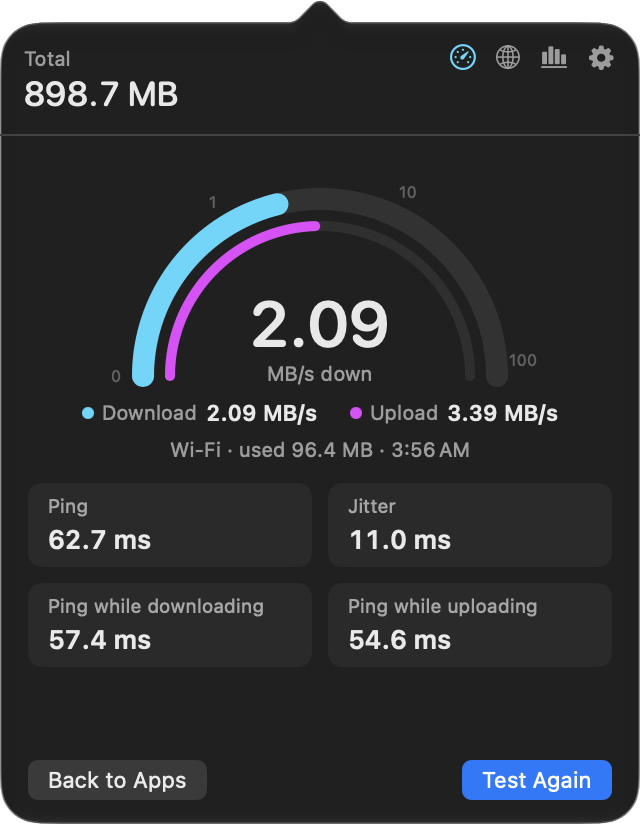

  

<h1 align="center">NetworkMonitor</h1>

  <b>Live network speed in your macOS menu bar — and the apps behind it.</b>

  
  
  
  
  

---

Your download and upload speed, always visible in the menu bar. Click it for
today's total and a per-app breakdown of who used it.

  

## Features

- **Live speed in the menu bar** — download and upload on two lines, updated twice
  a second, in MB/s or Mbps, at a fixed width so nothing jitters as the numbers
  change.
- **See which apps are using your data** — sorted biggest first, with icons.
  Chrome's dozen helper processes show as one *Google Chrome* row; OS daemons
  collapse into a single *System* row.
- **A total per connection** — join a different Wi-Fi network or hotspot and the
  totals start from zero, so what you see is what *this* connection has used. Open
  your hotspot somewhere new and you know exactly what each app spent on it. A
  dropout and a reconnect to the same network picks up where it left off.
- **Usage history** — every hour, per app and per network, kept for as long as you
  choose. Look back by day, week, month or year, see each visit to a network as a
  session, narrow it all to one app or one hotspot, and export it as CSV. See
  below.
- **Internet only, not LAN** — mirroring to an Apple TV, Time Machine to a NAS or a
  Plex stream from your own server all cross Wi-Fi, but none of them cost you
  internet data, so none of them are counted against you.
- **Hotspot aware** — metered connections are flagged with a `METERED` badge, and
  one setting stops your apps updating while you're on one, puts the connection in
  Low Data Mode, and tells you which apps it can't stop. See below.
- **Speed test on demand** — one click runs a fresh test with macOS's built-in
  `networkQuality`: download, then upload, then ping, jitter and ping under load.
  In Mbps or MB/s, and if another app was competing for the line, the result
  names it. See below.
- **Resets at midnight** too, for a connection you never leave, and survives
  restarts and reboots.
- **Stays out of the way** — no Dock icon, no app switcher entry, no window to
  manage. Just the menu bar.

## Privacy

NetworkMonitor watches your traffic *volume*, never its contents — and it has no
way to phone home.

- **No permission prompts.** It never asks for Location, and doesn't need it. The
  only thing that ever asks for your password is the hotspot helper, once, when
  you switch hotspot metering on.
- **No network access of its own.** The only traffic NetworkMonitor ever causes is
  a speed test you start yourself, run by macOS's built-in `networkQuality` against
  Apple's servers. There is no analytics, no telemetry, no update check, no account.
- **Your data stays on your Mac**, in local files you can delete at any time —
  Usage History has a button for it.
- **Open source, MIT licensed** — read every line before you run it.

## Install

For macOS 13 or later, on Apple silicon and Intel.

1. **[Download NetworkMonitor.dmg](https://github.com/kevinabouhanna/NetworkMonitor/releases/latest/download/NetworkMonitor.dmg)**,
   open it, and drag NetworkMonitor into **Applications**.
2. Open NetworkMonitor from Applications. The first time, macOS says it can't
   check it for malicious software and won't open it.
3. Open **System Settings › Privacy & Security**, scroll down to Security, and
   click **Open Anyway** next to NetworkMonitor. Confirm with your password.

That last step is there because NetworkMonitor isn't signed with a paid Apple
Developer ID yet, so macOS can't vouch for who made it. It's needed once; after
that it opens like any other app. It starts at login from then on — look for the
`↓`/`↑` readout in your menu bar.

**To update**, download the new disk image and drag it into Applications again,
replacing the old copy. Your settings and usage history stay.

## Using it

**Left-click** the menu bar item for this connection's total and the app list.
**Right-click** it to test your internet speed, for Usage History, for Settings,
to uninstall, and for Quit.

The **gear icon** opens Settings, where everything else lives, one pane each:

- **General**: start at login, whether speeds show in MB/s or Mbps, and the
  popover's totals (counting since, Reset Now).
- **Speed Test**: run a test right there, and choose how the popover shows one.
- **History**: Usage History. The popover's **chart icon** opens it directly.
- **Hotspot**: stopping apps updating on hotspots, and what that covers.
- **About**: the version, links, and Uninstall.

Settings reopens on the pane you last used. ⌘, opens it while it is in front.

Quitting and start-at-login are deliberately independent: quitting ends the app for
the rest of the session without turning the setting off, and turning the setting off
doesn't quit the running app.

## Speed test

  

Click the **gauge** in the popover, choose **Test Internet Speed** from the
right-click menu, or open **Settings › Speed Test**. NetworkMonitor runs `networkQuality`, the speed test Apple ships
with every Mac, against Apple's nearest servers:

- **Download, then upload**, one after the other as other speed tests do, with the
  dial following whichever half is running.
- **Ping and jitter** on a quiet line, and **ping while downloading and while
  uploading**: the figure that explains a call lagging while something else is
  busy. Hover over any figure for what it means.
- **Fresh every time.** Each run is a new measurement; nothing is cached or reused.
- **Names what slowed it down.** NetworkMonitor already knows which apps are using
  the connection, so if one was competing during the test, the result says so.
- **Mbps or MB/s**, one choice in Settings that the menu bar's live speed
  follows too. Mbps matches how your plan is sold; MB/s matches the data totals.
- **In the menu bar too.** While it runs, the readout shows the test in cyan, then
  holds the result for a few seconds before the live rates return. Start it from
  the right-click menu and that's where you watch it.
- **Card or compact**, chosen in Settings. The card takes the app list's place with
  a dial and every figure; compact shows the test as two lines above your apps,
  with ping and jitter beneath them, and keeps the list in view.

On the card, **Back to Apps** leaves the test running and brings the list back; the
gauge shows the live reading, and clicking it returns to the test. **Stop** is what
stops it.

A test uses data — typically 50–500 MB, more on a very fast line — so on a metered
connection it asks first and shows what the last test there cost. Its traffic shows
in the list as *Network Monitor › Speed test* and counts toward the total, because
those bytes really crossed the connection.

## Usage history

The popover's total starts over whenever you join a different network, and at
midnight. Usage History is where those totals go: click the **chart icon** in the
popover, choose **Usage History…** from the right-click menu, or open
**Settings › History**.

- **Day, Week, Month or Year**, with ‹ and › to step back through them. Days are
  split into hours, weeks and months into days, a year into months. Click a bar
  to open it.
- **Stacked by network type** — Wi-Fi, hotspot, Ethernet — with each type's total
  beside the chart, and hover over a bar for its figures.
- **Apps, Networks and Sessions.** Apps are grouped exactly as in the popover. A
  session is one visit to a network: from joining it until you leave for another,
  or until the Mac has been silent for half an hour, as it is after a sleep.
- **Click any row to see only its usage** — one app, one network or one session —
  and the chart and totals follow. **Metered only** does the same for every
  hotspot and other metered connection at once. Right-click a network to give it
  a name.
- **Kept for a month, three months, a year or forever** (the default), and
  **Export CSV…** saves what's on screen hour by hour, per app, in bytes.

History counts the same internet-only figure as the popover, so a mirrored screen
is no more part of it than of the total. It starts from the moment you install a
version that has it; nothing from before can be recovered.

## Stop apps updating on hotspots

One setting. Turn it on and NetworkMonitor switches off automatic updates
whenever you're on a mobile hotspot, then switches them back on when you leave.
Apps keep working normally — Chrome still browses, Slack still messages, VS Code
still edits — they just don't download new versions of themselves while you're
paying by the gigabyte. Nothing to configure, no per-app list to maintain.

It recognises tethering over Wi-Fi and over USB, from your phone or from someone
else's, and you can mark any other connection as metered by hand — a capped home
line, hotel Wi-Fi, a travel router.

Covered with no special permissions: **VLC, AppCleaner, ChatGPT, Affinity,
VoiceInk** and any other app using Sparkle; **Microsoft AutoUpdate**; **Figma**;
**Visual Studio Code**; and **Google Chrome**.

When you switch it on, macOS asks for your password once, so NetworkMonitor can
install a small helper. With it, the switch also covers **macOS system updates,
the App Store, Claude, Slack and Canva**, and puts the hotspot in Low Data Mode
(below). Those live in files only an administrator can change, which is why it
asks. Claude and Slack in particular honour *only* managed policy, so they can't
be covered any other way. The helper can do exactly five things — suppress,
restore, turn Low Data Mode on and off, report — and the settings it touches are
built into it, so it can't be asked to change anything else. Cancel the password
dialog and everything else still works; Settings shows an **Allow…** button for
when you change your mind. When a new version of NetworkMonitor needs a newer
helper, it asks once more, the first time it opens.

The helper also runs a small hourly check, so that if you delete NetworkMonitor
by dragging it to the Trash, **the helper's own** changes — the system update
settings, the managed policies, Low Data Mode — are put back and the helper
removes itself. It shows up as one extra row in System Settings › General ›
Login Items & Extensions; macOS lists every background job separately, and can
only group it under the app when the app is signed with a Developer ID.

Three things worth knowing:

- **Everything it changes is your app's own "check for updates automatically"
  setting**, not a firewall. A manual *Check for Updates…* still works, which is
  the point: it stops unattended downloads, not you.
- **"Stops updating" includes security updates.** There's no reliable way to tell
  a security patch from a feature release, and pretending otherwise would be
  worse than saying so. Turn the setting off, or leave the hotspot, and
  everything resumes.
- **Uninstall from the app, not by dragging it to the Trash.** Right-click the
  menu bar item and choose **Uninstall NetworkMonitor…**: it puts every setting
  back exactly as it found it, then removes itself. Dragging it to the Trash puts
  back the helper's changes but not the ones that needed no password, because the
  record of those is the app's own and nothing is left running to read it. If
  you've already trashed it, drag it back, open it, and uninstall from the menu.

### Low Data Mode, for the apps no setting reaches

The list above can only cover apps with an update setting NetworkMonitor knows
how to turn off, and your Mac has apps mine doesn't. So with the helper
installed, the same switch also puts the hotspot in **Low Data Mode** — the
flag macOS sets itself on an iPhone hotspot it recognises — and everything that
listens for it holds back: iCloud and Photos sync, background downloads macOS
schedules, and any app that respects Low Data Mode, whether NetworkMonitor has
heard of it or not. It's part of the one switch rather than a second one, since
it's there for the same reason; Settings says under the switch that iCloud waits
too.

- **It's a flag on the connection, not a setting saved anywhere.** Nothing is
  written to disk, your own Low Data Mode choices in System Settings are left
  alone, and a restart clears it whatever happens.
- **It only takes down what it put up.** If macOS or you had already turned it on
  for a connection, it stays on when you leave.
- **It's switched off when you leave the hotspot, and when you quit.** Unlike the
  update settings, it affects the whole Mac, so it doesn't stay behind on home
  Wi-Fi with nothing watching.
- **Settings shows whether it worked.** It reads the connection back afterwards,
  and says *macOS confirms it* once macOS itself reports the connection as
  constrained. If macOS keeps switching it back off, Settings says that too
  rather than fighting it.
- **Most Electron apps ignore it.** Chromium's networking doesn't listen for Low
  Data Mode, so it won't stop Slack-style apps on its own. That's what the next
  part is for.

### What isn't covered, and what got through anyway

Settings lists the apps on *your* Mac that update themselves in a way
NetworkMonitor can't switch off, under **Not covered**. They're found by how they
update — an Electron updater, a Sparkle app that's sandboxed, an updater program
of their own — not by a list of names, so the list reflects what you actually
have installed.

While you're on a metered connection, NetworkMonitor also notices updates that
download anyway: an update file appearing where Electron and Sparkle apps stage
their downloads, or a program named like an updater using the connection. The
popover shows one line under the total when that happens, and Settings lists
each one with its size, still there after you've left the hotspot.

## What the numbers mean

**Your speed and connection total are always accurate.** They come straight from the
kernel's own byte counters, cost about a tenth of one percent of a CPU core, and run
all the time. They've been measured at 99.6–100.2% agreement with the kernel across
three independent transfers.

**Per-app numbers now run all the time too**, on every network and on battery, with
no setting to forget. That used to cost about 1.4 CPU cores, which is why earlier
versions switched per-app tracking off unless you were plugged in. The cost turned
out to be a bug, not a price: the tool macOS provides polls its input for
keystrokes, it was being given an input that is always "ready", and so it spun on
an empty loop forever. Given an input that waits properly, the same data costs
**0.55% of a core** — 256× less — and arrives just as fast.

It also adapts on its own, with nothing to configure: **plugged in**, it samples
every second for the freshest possible numbers; **on battery**, every three seconds.
Your totals are identical either way — the tool reports the bytes moved *between*
samples, so sampling less often changes how fresh the figures are, not how complete.
Settings tells you which mode is in force.

So there is nothing left worth switching off, and nothing to trade. Per-app rows
still won't quite add up to the connection total: some traffic is wire-level
overhead belonging to no app, and the final second before you quit is never
completed. **The big total is the one to trust.**

> Numbers here won't match Activity Monitor or TripMode, and shouldn't. Activity
> Monitor counts bytes since each process *started* — often days ago. This app
> reports what it saw on the connection you are on, since you joined it.

## Uninstall

Right-click the menu bar item and choose **Uninstall NetworkMonitor…**, or open
**Settings › About** and click **Uninstall…**.

It puts back every setting hotspot metering changed *before* it removes anything,
removes the helper (macOS asks for your password if the helper is installed),
removes the login item and your usage history, and moves the app to the Trash.

**Dragging the app to the Trash is not equivalent** — the settings that need no
password stay switched off, because the record of how to undo them needs the app
to read it. If you've already done that, drag it back, open it, and uninstall
from the menu.

## Building from source

For contributors. Using the app never needs any of this.

You'll need Apple's Command Line Tools (`xcode-select --install`); Xcode and a
developer account are not required. `make test` runs the suite, `make app`
builds `build/NetworkMonitor.app` with its helper inside, `make dmg` builds the
universal disk image, and `make metering-report` prints what hotspot metering
reaches on the machine it runs on. A release is cut by pushing a `v*` tag; the
workflow builds, tests and publishes the disk image.

## License

MIT — see [LICENSE](LICENSE).
