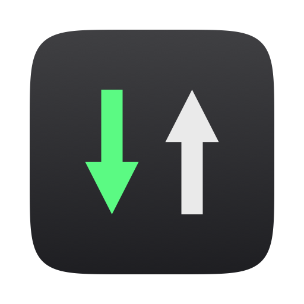
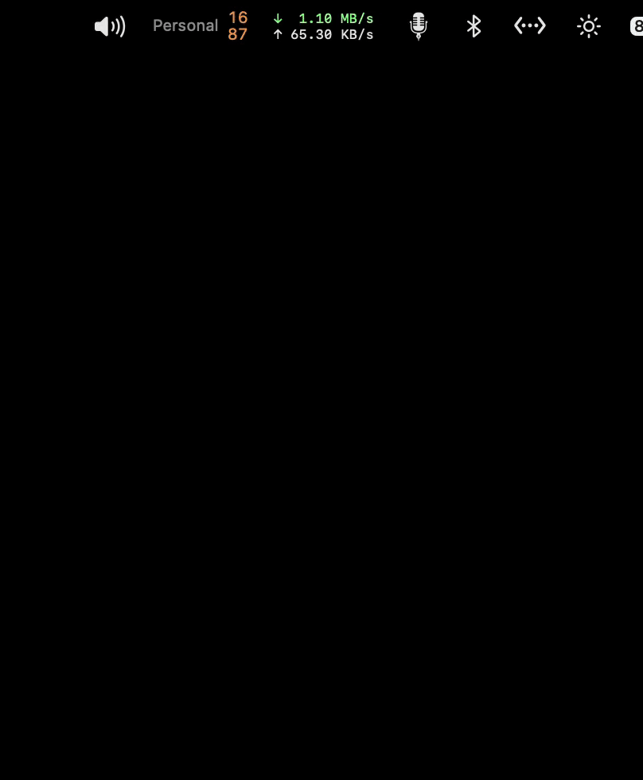

<p align="center">
  
</p>

<h1 align="center">NetworkMonitor</h1>

<p align="center">English · <a href="README.zh-Hans.md">简体中文</a></p>

<p align="center">
  <b>Live network speed in your Mac's menu bar, which apps used your data, and a firewall to block what they connect to.</b>
</p>

<p align="center">
  <a href="https://github.com/kevinabouhanna/NetworkMonitor/releases/latest"></a>
  
  <a href="https://github.com/kevinabouhanna/NetworkMonitor/actions/workflows/ci.yml"></a>
  
</p>

<p align="center">
  <a href="https://github.com/kevinabouhanna/NetworkMonitor/releases/latest/download/NetworkMonitor.dmg"><b>Download</b></a> ·
  <a href="https://kevinabouhanna.github.io/NetworkMonitor/">Website</a> ·
  <a href="docs/README.md">Docs</a> ·
  <a href="https://github.com/kevinabouhanna/NetworkMonitor/wiki">Wiki</a>
</p>

<p align="center">
  
</p>

## ✨ Features

- ⚡ **Live speed** in the menu bar, download and upload, in MB/s or Mbps, in colours you choose.
- 📊 **Which apps used your data** today, this week or this month, biggest first, and on which networks.
- 🌐 **Connections:** which companies, countries and servers each app talks to, on a list and a world map, without looking anything up online. Block any of them, or have it ask.
- 🛡️ **Block ads, trackers and malware** in every app, Chrome included, with one switch.
- 🏠 **Internet only.** AirPlay, Time Machine and other home-network traffic don't count.
- 📱 **Hotspot mode** pauses app updates on a mobile hotspot, and resumes them when you leave.
- 🗓️ **Usage History** by day, week, month or year, per app and per network.
- 🚀 **Speed test** on demand, using the one built into macOS.
- 🔋 **Light on battery:** about 1% of one CPU core, less in Low Power Mode.
- 🔒 **Private:** no telemetry, no account. Its own network access is a monthly download of country and network data, a weekly one of the ad and malware lists while they're on, and a daily update check, all from GitHub, and all can be switched off.

## 📦 Install

For macOS 13 or later, on Apple silicon or Intel.

1. [**Download NetworkMonitor.dmg**](https://github.com/kevinabouhanna/NetworkMonitor/releases/latest/download/NetworkMonitor.dmg), open it, and drag NetworkMonitor into **Applications**.
2. Open NetworkMonitor from Applications.

It's signed with an Apple Developer ID and notarized by Apple, so macOS opens it without a warning. The code is all here to read, or to [build yourself](docs/development.md).

Look for the ↓ ↑ readout in your menu bar. It starts at login from then on.

### 🔄 Update

From 1.15 on, NetworkMonitor offers each new version itself, once a day or when you choose **Check for Updates…** in its menu, and installs it when you say so.

Before that, download the new DMG and drag NetworkMonitor into Applications, choosing **Replace**. Your settings and history are kept. Updating from 1.13 or earlier, macOS asks for Location once more, because the app is now signed with a Developer ID.

### 🗑️ Uninstall

Right-click the menu bar readout and choose **Uninstall NetworkMonitor…**, or click it at the bottom of Settings. It puts back every setting it changed, then moves itself to the Trash.

> [!WARNING]
> Don't just drag it to the Trash: the update settings that Hotspot mode changed without its helper would stay off. If you already did, drag it back, open it, and uninstall from the menu.

## 🖱️ Using it

- **Click** the readout for today, this week or this month: the data your apps used, who they connected to, the ads blocked, and the network you're on.
- **Right-click** it for the speed test, Block Everything, Usage History, Connections, Ads and Trackers, Network, Settings, About, Check for Updates, Uninstall and Quit.
- **The main window** has a sidebar: Usage History, Connections, Ads and Trackers and Network, with Settings at the bottom. The gear in each section's toolbar holds that section's settings.

## 📚 Learn more

The [docs](docs/README.md) explain how every feature works, and why. They're also on the [wiki](https://github.com/kevinabouhanna/NetworkMonitor/wiki).

- **Using it:** [installing](docs/installing.md) · [features](docs/features.md) · [Connections](docs/connections.md) · [Usage History](docs/usage-history.md) · [speed test](docs/speed-test.md) · [Hotspot mode](docs/hotspot-mode.md) · [accuracy and battery](docs/accuracy-and-battery.md) · [privacy](docs/privacy.md)
- **Working on it:** [architecture](docs/architecture.md) · [building and releasing](docs/development.md) · [decisions](docs/decisions.md) · [roadmap](docs/roadmap.md)

## 🤝 Contributing

Issues and pull requests are welcome. Building needs only Apple's Command Line Tools:

```sh
xcode-select --install
make test   # run the test suite
make app    # build build/NetworkMonitor.app
```

See [docs/development.md](docs/development.md) for the rest.

## 📄 License

[Apache License 2.0](LICENSE)
