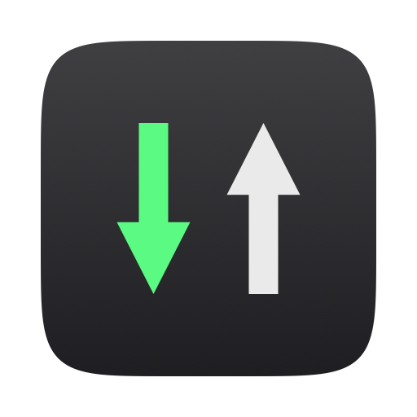

<p align="center">
  
</p>

<h1 align="center">NetworkMonitor</h1>

<p align="center"><a href="README.md">English</a> · 简体中文</p>

<p align="center">
  <b>在 Mac 菜单栏中显示实时网速，告诉你哪些应用用掉了流量，还可通过防火墙控制各应用的网络连接。</b>
</p>

<p align="center">
  <a href="https://github.com/kevinabouhanna/NetworkMonitor/releases/latest"></a>
  
  <a href="https://github.com/kevinabouhanna/NetworkMonitor/actions/workflows/ci.yml"></a>
  
</p>

<p align="center">
  <a href="https://github.com/kevinabouhanna/NetworkMonitor/releases/latest/download/NetworkMonitor.dmg"><b>下载</b></a> ·
  <a href="https://kevinabouhanna.github.io/NetworkMonitor/zh/">网站</a> ·
  <a href="docs/zh-Hans/README.md">文档</a> ·
  <a href="https://github.com/kevinabouhanna/NetworkMonitor/wiki/Home-zh-Hans">Wiki</a>
</p>

<p align="center">
  
</p>

## ✨ 功能

- ⚡ <strong>实时网速</strong>显示在菜单栏中，包括下载和上传，单位可选 MB/s 或 Mbps，颜色由你选择。
- 📊 <strong>哪些应用用掉了流量</strong>：显示今天、本周或本月各应用的用量，从多到少排列，以及用在了哪些网络上。
- 🌐 <strong>连接</strong>：每个应用在和哪些公司、国家或地区、服务器通信，以列表和世界地图显示，无需在线查询。你可以阻止其中任何一个，或者让它先询问你。
- 🛡️ <strong>拦截广告、跟踪器和恶意软件</strong>：一个开关即可在所有应用中生效，Chrome 也不例外。
- 🏠 <strong>只统计互联网流量。</strong>隔空播放、时间机器和其他家庭网络内的流量不计入。
- 📱 <strong>热点模式</strong>：使用移动热点时暂停应用更新，离开热点后恢复。
- 🗓️ <strong>流量历史</strong>：按日、周、月或年查看，可按应用和网络细分。
- 🚀 <strong>网速测试</strong>：随时可用，使用 macOS 内置的测速工具。
- 🔋 <strong>省电</strong>：大约占用一个 CPU 核心的 1%，低电量模式下更少。
- 🔒 <strong>注重隐私</strong>：没有遥测，不需要账户。它自己只会联网做这几件事：每月下载一次国家或地区和网络数据，打开广告和恶意软件列表后每周下载一次列表，每天检查一次更新。这些都来自 GitHub，而且都可以关闭。

## 📦 安装

适用于 macOS 13 或更高版本，支持 Apple 芯片和 Intel 芯片的 Mac。

1. [<strong>下载 NetworkMonitor.dmg</strong>](https://github.com/kevinabouhanna/NetworkMonitor/releases/latest/download/NetworkMonitor.dmg)，打开它，然后将 NetworkMonitor 拖到 <strong>应用程序</strong> 文件夹中。
2. 从“应用程序”文件夹中打开 NetworkMonitor。

也可以用 [Homebrew](https://brew.sh) 安装：

```sh
brew install --cask kevinabouhanna/tap/networkmonitor
```

它使用 Apple Developer ID 签名，并经过 Apple 公证，所以 macOS 打开它时不会显示警告。全部代码都在这里，你可以阅读，也可以[自己构建](docs/development.md)（英文）。

在菜单栏中找到 ↓ ↑ 读数。从此以后，它会在你登录时自动启动。

### 🔄 更新

从 1.15 开始，NetworkMonitor 会自己提示新版本：每天检查一次，或者在你从它的菜单中选择 <strong>检查更新…</strong> 时检查，并在你同意后安装。

在此之前的版本，请下载新的 DMG，将 NetworkMonitor 拖到“应用程序”文件夹中，并选择 <strong>替换</strong>。你的设置和历史记录都会保留。从 1.13 或更早版本更新时，macOS 会再询问一次定位服务权限，因为应用现在使用 Developer ID 签名。

### 🗑️ 卸载

右键点按菜单栏读数，然后选择 <strong>卸载 NetworkMonitor…</strong>，或在“设置”底部点按它。它会恢复它更改过的每项设置，然后把自己移到废纸篓。如果你是用 Homebrew 安装的，请先这样做，再运行 `brew uninstall --cask networkmonitor`。

> [!WARNING]
> 不要直接把它拖到废纸篓：热点模式在没有辅助程序的情况下关闭的更新设置会一直保持关闭。如果你已经这样做了，请把它拖回来，打开它，再从菜单中卸载。

## 🖱️ 使用方法

- <strong>点按</strong>读数，可查看今天、本周或本月的情况：你的应用用掉的数据、它们连接了谁、拦截了多少次广告，以及你正在使用的网络。
- <strong>右键点按</strong>读数，可使用测试网速、全部阻止、流量历史、连接、广告与跟踪器、网络、设置、关于、检查更新、卸载和退出。
- <strong>主窗口</strong>有一个边栏：流量历史、连接、广告与跟踪器和网络，“设置”位于底部。每个部分工具栏中的齿轮图标里是该部分自己的设置。

## 📚 了解更多

[文档](docs/zh-Hans/README.md)介绍了每项功能是如何工作的，以及为什么这样设计。这些内容也在 [Wiki](https://github.com/kevinabouhanna/NetworkMonitor/wiki) 上。

- <strong>使用：</strong>[安装](docs/zh-Hans/installing.md) · [功能](docs/zh-Hans/features.md) · [连接](docs/zh-Hans/connections.md) · [流量历史](docs/zh-Hans/usage-history.md) · [网速测试](docs/zh-Hans/speed-test.md) · [热点模式](docs/zh-Hans/hotspot-mode.md) · [统计准确性与耗电量](docs/zh-Hans/accuracy-and-battery.md) · [隐私](docs/zh-Hans/privacy.md)
- <strong>开发（英文）：</strong>[架构](docs/architecture.md) · [构建与发布](docs/development.md) · [决策](docs/decisions.md) · [路线图](docs/roadmap.md)

## 🤝 参与贡献

欢迎提交问题和拉取请求。构建只需要 Apple 的 Command Line Tools：

```sh
xcode-select --install
make test   # run the test suite
make app    # build build/NetworkMonitor.app
```

其他内容请参阅 [docs/development.md](docs/development.md)（英文）。

## 📄 许可证

[Apache License 2.0](LICENSE)
