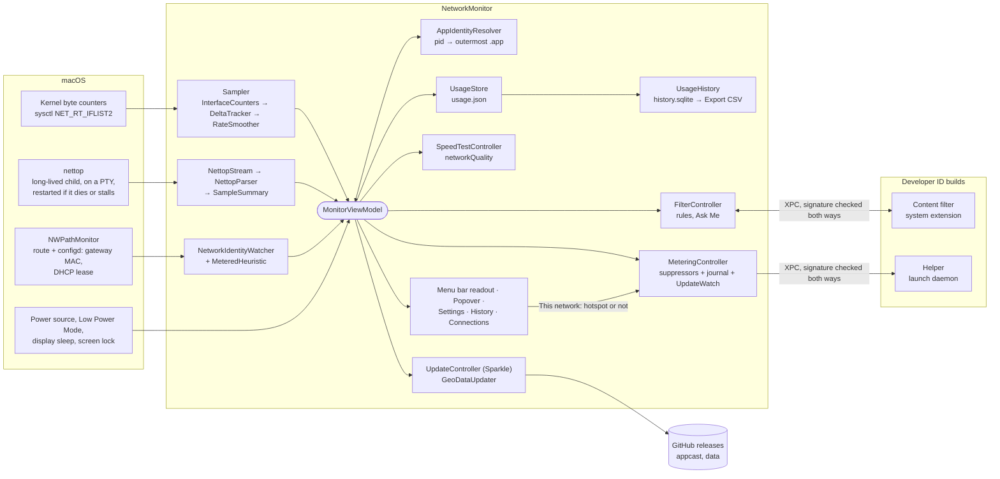

# Architecture

NetworkMonitor is one menu bar process that runs `nettop` as a long-lived child. A
build signed with the Developer ID adds two parts macOS runs on its behalf, each allowed
once by you: a **content filter** (a system extension) for Connections, blocking and
Hotspot mode, and a **helper** (a launch daemon) for the system settings Hotspot mode
changes. It goes online for three things only: a [speed test](speed-test.md) you
start, the daily [update check](installing.md), and the
[monthly country data](privacy.md#what-it-sends).

## How data flows



**`MonitorViewModel` is the hub, and holds little logic of its own.** It owns the parts
and passes each one what it needs: the samplers' figures to the store, network changes
to Hotspot mode, nettop's processes to Connections. The decisions are made in the parts,
and each is tested on its own: `SampleSummary` folds a nettop sample into apps, servers
and LAN bytes; `MeteredHeuristic` decides what's a hotspot; `MeteringController`,
`UpdateWatch`, `FirewallPolicy`, `UsageStore` and `UsageHistory` keep their own state.
`AppDelegate`, in the thin `NetworkMonitor` target, owns the status item, the popover,
the right-click menu and the windows.

**Where the rest is described:**
- **Hotspot detection and its manual override:**
  [Hotspot mode](hotspot-mode.md#what-counts-as-a-hotspot). *This network* in Settings
  beats every check.
- **How the helper is reached:** [Hotspot mode › The helper](hotspot-mode.md#the-helper).
  It's over XPC, the helper answers only NetworkMonitor signed by the team, and the app
  only talks to a helper signed by it.
- **The content filter and blocking:** [Connections](#connections-which-servers-each-app-talked-to)
  below.
- **What asks for permission, and what each permission unlocks:**
  [Privacy › Permissions](privacy.md#permissions).
- **Retention, pruning and Export CSV:** [Usage History](usage-history.md).
- **VPNs and several interfaces:** below. The total counts a tunnel's traffic once, on
  the physical interface, and a network is named after the interface carrying the
  default route, never a tunnel.

## Threads

| Queue | What runs there |
|---|---|
| main | `MonitorViewModel`, `UsageStore` and every write to it, `AppIdentityResolver` (it touches `NSWorkspace`), notifications, the UI |
| `com.networkmonitor.sampler` | reading the kernel counters, deltas and smoothing |
| `com.networkmonitor.nettop` | spawning `nettop`, reading its PTY, parsing |
| `com.networkmonitor.path` | path changes, the 2-second debounce, gateway lookup |
| `com.networkmonitor.history` | Usage History reads (writes happen on main) |

## Two sources, on purpose

### The kernel's counters: the total you can trust

Every 0.5 to 2 seconds (see [power profiles](accuracy-and-battery.md#battery)), the
sampler reads every interface's lifetime byte counters with
`sysctl(NET_RT_IFLIST2)`. These are the 64-bit counters `netstat -ib` shows.
`getifaddrs()` was rejected: its counters are 32-bit and wrap every 4 GiB, which had
already turned a true 5.52 GB into 1.23 GB.

- **Which interfaces count:** physical ones (`IFT_ETHER`), up, not loopback, and not on
  a short exclusion list: `awdl` (AirDrop, Sidecar), `llw`, `ap`, `bridge` and `bond`
  (which would double-count their members), `vmenet` (VM networking), `anpi` and `XHC`.
  VPN tunnels aren't `IFT_ETHER`, so encrypted traffic is counted once, on the physical
  interface.
- **Deltas never spike.** The first reading of an interface is its baseline and adds
  nothing; a counter going backwards (the interface was reset) re-baselines; an
  interface that disappears and returns starts again from a baseline. So the app never
  bills you for traffic from before it started.
- **The live rate** is an exponential moving average (α = 0.7) over a monotonic clock,
  snapping to zero when traffic stops so an idle Mac shows no ghost rate.

The headline total doesn't depend on `nettop` at all. It was checked with `nettop`
suspended: a 20 MB download was recorded at 99.9% of the kernel's own count.

### nettop: who used it

macOS has no public API for network use per process, but it ships `nettop`, which works
without privileges, even for processes owned by root. NetworkMonitor runs **one
long-lived** `nettop`:

```
nettop -n -x -d -L 0 -s <1|3|10> -t external -J time,bytes_in,bytes_out
```

| Flag | Why |
|---|---|
| `-n` | Numeric addresses. The LAN/internet split needs the address, and a reverse DNS lookup would be the monitor generating traffic |
| `-x` | Raw byte counts |
| `-d` | **Delta mode.** Cumulative totals fall when sockets close, so diffing them under-counted browsers |
| `-L 0` | CSV output, unlimited samples |
| `-s N` | Seconds per sample, from the power profile. Each sample is a delta, so a longer interval changes freshness, not totals |
| `-t external` | All non-loopback interfaces: keeps VPN traffic, drops localhost chatter from dev servers |
| no `-P` | `-P` collapses each process to one row and throws away the per-connection rows that carry the remote address |

<a id="nettop"></a>How it's run matters as much as the flags:

- **stdout is a pseudo-terminal.** Through a pipe, `nettop` block-buffers and delivered
  one 16 KB block about every 30 seconds.
- **stdin is a pipe nobody writes to.** `nettop` polls stdin for keystrokes, and
  `/dev/null` is always ready to read, so with it `nettop` spun at about 140% of a CPU
  core forever. That was the battery drain reported in
  [issue #1](https://github.com/kevinabouhanna/NetworkMonitor/issues/1). With a blocking
  pipe it's well under 1%.
- **Read with `read(2)`**, not `FileHandle.availableData`, which raises an Objective-C
  exception Swift can't catch when the PTY closes.
- **The first sample is discarded:** in delta mode it's a cumulative baseline.
- **A sample is closed after 120 ms of quiet** rather than when the next header arrives,
  which would add a whole interval of latency (the first sample after launch took 2.05 s
  instead of 1.24 s).
- **Restarts back off** from 1 to 30 seconds if it dies or can't be launched, and the
  popover says per-app figures are paused until a sample arrives again.
- **A stall is a fault too** (#110). `nettop` writes a header every interval even when
  nothing moves, so five intervals without a sample, and at least 30 seconds, means it's
  hung, or a new macOS has changed its output so that no sample is recognised. Either
  way it's restarted. The first time, nothing is said; a second stall in a row, or
  output that arrives but can't be read, puts the paused line in the popover. The clock
  stops while the Mac sleeps, so waking up isn't taken for a stall. Changing the interval means
  restarting it, so it only changes with the power source or Low Power Mode, never with
  screen sleep or the popover.
- **Never orphaned.** Replacing it detaches its termination handler, sends `SIGTERM` and
  escalates to `SIGKILL`. Quit signals are routed through a normal quit. Any `nettop`
  left behind by a crash is reaped at the next launch. (A `pkill` of the app once left
  one holding 1.4 cores.)

### From process to app

Each `nettop` row is a process name and pid, followed by its connections.
`AppIdentityResolver` turns a pid into an app:

1. `proc_pidpath` gives the executable's path.
2. The **outermost** `.app` in that path is the app, so Chrome's dozen helper processes
   all become one *Google Chrome* row. Process names can't be keys: `nettop` truncates
   them to 15 characters.
3. A process outside any `.app` is **adopted** by its nearest ancestor that is one,
   walking up to 8 parent pids. So `node`, `git` or `curl` started from a terminal or an
   editor shows as a child of iTerm2 or VS Code instead of vanishing into System. A
   process's own path is tried first, so a helper that ships inside another app's
   bundle stays with that app.
4. Anything left (daemons, `kernel_task`) is **System**, one collapsed row, because
   `mDNSResponder` alone was measured at 263 MB against 6 MB for the top real app.

Rows with the same app merge, an app's total includes its children, and an app shows at
most four children: the top three, then *Other (n)* for the rest, so the numbers still
add up. pid → app lookups are cached and evicted when a pid disappears, because macOS
reuses pids.

### Internet, not your own network

Each connection's remote address is classified (`TrafficScope.swift`):

| Scope | Addresses | Effect |
|---|---|---|
| internet | everything else, including CGNAT `100.64/10`, and anything unparseable | counted |
| local unicast | `10/8`, `172.16/12`, `192.168/16`, `169.254/16`, loopback, IPv6 link-local and ULA | left out of app rows, **subtracted** from the total |
| local multicast | `224/4`, broadcast, `ff00::/8`, and wildcard sockets on mDNS, SSDP, DHCP and similar ports | left out of app rows, **not** subtracted |

Multicast isn't subtracted because `nettop` over-reports it: `mDNSResponder`'s socket
listens on several interfaces at once and `nettop` bills its full count to each. Measured
claims came out at least 12.6 times what the interface physically carried. Anything
that can't be classified counts as internet, because **under-reporting is the one error
this app can't afford**.

The headline is then clamped, per direction:

```
internet = min(kernel, max(kernel − local unicast, sum of app rows))
```

It's never below what the app rows prove went to the internet, and never above what the
kernel counted. Without the clamp, a measured 90 seconds gave 367 KB of "internet" with
1,174 KB of app rows beneath it, which isn't an estimate but a contradiction.

## A total per connection

**Telling networks apart.** A network is identified by its default gateway's hardware
address, stored as `gw:<mac>`. The gateway's IP comes from `route -n get default`, and
its address from configd (`ARPResolvedHardwareAddress` in the service's IPv4 state), then
`arp`. Its Wi-Fi name would need Location permission. The gateway address needs none,
tells apart two routers with the same Wi-Fi name, and stays the same while roaming
between access points. With no address (a captive portal, IPv6-only) it falls back to
the interface and the gateway's IP, `if:en0@172.20.10.1`. Path changes are debounced for
2 seconds, longer than a DHCP burst.

**Wi-Fi names** (`WiFiNames.swift`, issue #85). The name is a label, kept per network in
`usage.json` (`wifiNames`), first seen first. macOS 27 shares it only with Location
permission: without it CoreWLAN's `ssid()` is nil, configd's `SSID_STR` is empty and
`ipconfig getsummary` prints `<redacted>`. So the app asks with
`requestAlwaysAuthorization()` when the person turns names on, in the welcome window or
Settings › General (#134; macOS has no "while using"), reads
`ssid()` on the path watcher's queue once allowed, and evaluates the path again when the
answer changes. A name arriving for the network already in use is not a change of link,
so it doesn't re-baseline the counters. Releases are all signed with one certificate,
so the answer survives updates (issue #86); an ad-hoc build is a new app to macOS and is
asked again.

**Why configd** (issue #70). macOS 27 hides the ARP table from apps without Local Network
permission: `arp` run by the app answers "no entry" for a router a terminal can see.
From 27.0.1 until 1.9.7, every network on Wi-Fi therefore fell back to one key, `if:en0`,
and home Wi-Fi and an iPhone hotspot were one network. configd resolves the router
itself and publishes it to any process.

**Buckets** (`UsageStore.swift`). Each network has a bucket: kernel bytes, LAN bytes,
per-app totals, and when counting started.

- **Joining a different network** clears that network's bucket, even if it has
  figures from earlier today. The bucket you left keeps its figures until midnight.
- **Going offline is not a switch.** A Wi-Fi drop and a rejoin resume the same count.
  Bytes seen while offline are merged into the next network.
- **Relaunching** on the same network resumes, because the last network is saved. A
  lid closed in one place and opened in another is a real switch.
- **Midnight** (local, not a rolling 24 hours) clears every bucket. It's checked on
  every sample and on wake, because timers don't fire during sleep.
- **Reset Now** clears the current network only. Resetting all exists in code but isn't
  offered, since the popover never names the network.
- **Counting since** is stored per bucket and shown in Settings, so a total is never
  read over the wrong window.

**Saving.** `~/Library/Application Support/NetworkMonitor/usage.json`, written to a
temporary file then swapped in, about every 15 seconds and on every network change,
popover close, sleep and quit. A crash loses at most those 15 seconds; a torn write
can't corrupt it. Every field decodes as optional, so old files load after an upgrade,
and a file that can't be read starts the day afresh rather than blocking launch. Usage
History is written on exactly the same occasions; see [Usage History](usage-history.md).

## The menu bar readout

Two stacked lines, `↓` download in green (`#51FF70`) over `↑` upload in light grey
(`#E5E5E5`), the arrows' colours in the app icon.

- **Fixed width.** Each rate is a five-character number field and a four-character unit
  field in a fully monospaced 8.5-point font, so nothing beside it moves as the numbers
  change. A digits-only monospaced font let the width wander between 97 and 126 points.
  In bits the units are written `Kb/s` and `Mb/s` to stay four characters.
- **Drawn into an image.** `NSButton` lays out a two-line title with one-line
  assumptions and clipped the top line at every font size tried. Left alignment, because
  right alignment makes CoreText drop the trailing padding. Not a template image, which
  would lose the colours.
- **Redrawn only when the text changes.** Each redraw is a round trip to WindowServer;
  an idle Mac redraws nothing. While nobody can see the menu bar (display asleep, screen
  locked, another user's session in front), nothing is drawn at all, and the readout is
  redrawn and resampled the moment someone can.
- **Colours you choose.** Settings › General changes both lines (`MenuBarColors`). A colour
  is saved as sRGB `#RRGGBB`, and only while it differs from the default, so a later
  default reaches everyone who never picked one.
- **A speed test takes it over** at the same width, and holds the result for 8 seconds.
  It's drawn in the first of four pairs (cyan, pink, amber, violet) whose colours stay clear
  of both live ones, measured in OKLab: at least 0.15 for its download colour and 0.05 for
  its pale upload colour. With the default colours that's always cyan.

## App lifecycle

- **Startup** (`main.swift`): accessory activation policy (menu bar only, no Dock icon);
  three command-line switches for the scripts (`--unregister-login-item`,
  `--revert-metering`, `--metering-report`); a **single-instance guard**, since two
  copies would each run a `nettop` and double-count every byte; and quit signals
  (`SIGTERM`, `SIGINT`, `SIGHUP`) routed through a normal quit, so `nettop` is always
  stopped.
- **Start at login** uses `SMAppService.mainApp`, which works with an ad-hoc signature.
  It replaced a hand-written LaunchAgent, which Login Items showed as a generic "exec"
  tile because macOS ignores `AssociatedBundleIdentifiers` without a Team ID. It's on by
  default, set exactly once, so turning it off is never undone. There's no `KeepAlive`:
  **Quit** stays quit until the next login.
- **While Settings is open**, the app becomes a regular app with a Dock icon, a main
  menu (for ⌘W, ⌘, and ⌘Y) and a ⌘-Tab entry, then goes back to menu bar only when
  Settings closes. Without that, revealing an auto-hidden menu bar activated another app,
  whose windows covered Settings with no way back to it.
- **The popover leaves Settings where it is** (issue #71). Activating the app for the
  popover brought Settings forward over the app you were in, and AppKit makes it the main
  window for that whatever it's told. So Settings goes off screen for that moment and
  straight back below the window that was in front of it (`WindowStack`). Esc or a second
  click on the item hands focus back to that app. ⌘-Tab, the Dock icon or a click on
  Settings closes the popover and shows Settings alone.

### The auto-hidden menu bar

Several fixes exist only because of macOS's "Automatically hide and show the menu bar"
(issue #6):

- **The popover is anchored to an invisible window** placed over the status item when
  you click, because with the bar hidden the status item resolves off-screen and the
  popover re-anchored to the far left whenever its content resized.
- **The popover is semi-transient**, not transient: revealing the bar activates the
  previously frontmost app, which closed a transient popover. The app decides when to
  close it: on Esc, a click elsewhere, or switching to another app.
- **The menu bar is 30 points tall on macOS 27**, while `NSStatusBar.system.thickness`
  still says 22. The real height comes from the status item's own window, and keeps
  Settings' title bar clear of a revealed bar.

## Performance decisions in the UI

- **Live rates aren't `@Published`.** `@ObservedObject` invalidates on any change, so
  publishing them re-measured the hidden popover twice a second. A plain signal tells
  `AppDelegate` when the title changed.
- **The app list is rebuilt only while the popover is open.** Counting never stops;
  only showing it waits for someone to look.
- **The speed test's live readings** are a separate object from its phase, so the app
  list isn't rebuilt five times a second during a test.
- **The popover's height is computed** from the number of rows, not measured, so it
  never starts from zero and the list never strobes a scrollbar. The list stops at 372
  points, eight rows and part of a ninth, so the cut-off row says "more below".
- **Command Line Tools constraints**: no `@State` (it's an Xcode-only macro in the macOS
  27 SDK), so view state lives in small `ObservableObject`s. See
  [development](development.md#command-line-tools-quirks).

## Connections: which servers each app talked to

`nettop`'s connection rows carry the far end's address. The LAN split above uses them
to recognise local traffic, and since #111 the internet ones are kept too:

1. **`NettopParser`** adds each internet socket's bytes to its process row's `servers`,
   by address. A wildcard peer has no address, and its bytes count only through the
   process row.
2. **`MonitorViewModel`** folds the processes into apps, as it does for the popover, and
   hands `UsageHistory` each app's bytes by server.
3. **`UsageHistory`** stores them hourly, per visit to a network. Each app and server
   pair is stored once (`app_servers`, with the hour it was first seen), so the hourly
   rows (`server_traffic`) carry a small number rather than an app's path. An app keeps
   at most 500 servers by address in an hour; past that, a BitTorrent client's peers or
   a big call's are added up under `*`, so one app can't grow the file without bound.
   Servers are written in a transaction of their own, so a failure there can't cost
   Usage History its figures. Retention and **Clear History** cover them like the rest.
4. **`ServerDirectory`** names them when they're read: the country, and the network's
   owner and company, from DB-IP's data in `Resources/Geo`. Naming at read time means a
   newer copy of the data improves old records too. Its files are sorted range starts,
   memory-mapped, and found with a binary search, so a lookup reads a few pages.

5. **The Connections window** (`ConnectionsWindowController`, `ConnectionsViewModel`,
   `ConnectionsView`) asks `UsageHistory.loadServers` for a span and the period's hourly
   totals, names the servers off the main thread, and groups them with
   `ConnectionsReport`, which is pure and tested. Grouping, narrowing and search only
   regroup what's loaded, so they answer at once. Each app's maker comes from its code
   signature (`AppMaker`).

6. **The content filter** (#128, `Sources/NetworkMonitorFilter`) is a Network Extension
   system extension, in the bundle at `Contents/Library/SystemExtensions/` only in
   Developer ID builds. `FilterController` installs it (`OSSystemExtensionRequest`),
   switches it on (`NEFilterManager`), and listens for what it saw over XPC on
   `GRQKG7M8CL.com.kevinabouhanna.NetworkMonitor.Filter`. Both ends check each other's code
   signature by team. Each new flow is allowed and reported in batches; its name goes to
   `UsageHistory.noteServerNames`, and `Company.named(byHostname:)` names the company,
   so a host's customer is no longer *Hosted on…*. The contract between the two lives in
   `FilterProtocol`, Foundation only. It's offered, never switched on unasked: in the
   welcome window (`WelcomeWindowController`) on first launch, and by `WebsiteNamesRow`
   in Settings › Connections and the Connections window (#134). `FilterController`
   follows `NEFilterConfigurationDidChange`, so turning it off in System Settings shows.
   At each launch with the filter on, it asks macOS to activate the extension in its own
   bundle: macOS keeps running the one it last activated, so without this an update never
   reached the filter (#136). It connects only once that request is through. Even so, a
   swap now and then left the new filter's launchd job with no Mach service, and every
   look-up failed until a restart (twice in six swaps): every version declared the same
   name, and the outgoing one could still hold it. So each build's name is its own,
   `…NetworkMonitor.Filter.<build>`, stamped by `bundle.sh` and read from the filter's
   Info.plist at both ends (#142).

7. **Blocking** (#114). `FirewallPolicy`, Foundation only, holds the rules, the mode and the
   decision, and `AppKey` the folding of an executable path into the app Connections lists
   it under, shared with `AppIdentityResolver`. The app keeps the rules (`FirewallRules`) and
   sends the filter a `FirewallPolicy` over XPC on connecting and after every change,
   hotspot state included; the filter stores it in its container and applies it from
   launch. For each new flow it works out the app keys from both audit tokens (the app the
   flow is for and the process making it), through `proc_pidpath` and the parent chain,
   which the sandbox allows; whether Apple signed it (`anchor apple`); the company, from the
   hostname or the address's owner; and the country. The country and owner tables live in
   the extension's bundle, which runs from `/Library/SystemExtensions`, and the app's
   `Resources/Geo` links to them there, so they ship once. With no rules and the default
   mode it looks nothing up. A blocked flow is reported with its rule and the app it was
   for (the app token's key, as the process may be gone), and Usage History counts it in
   `server_traffic.blocked`, beside the bytes, so Connections shows it through the same
   queries (`ServerMeasure`).

   **Ask Me** (#129): a flow nothing decided gets `NEFilterNewFlowVerdict.pause()`, and the
   filter sends the app a `FlowQuestion` over XPC, one per app and company, holding every
   flow between them on it. The answer comes back as a `FlowAnswer` and the filter resumes
   them through the provider; with none in 30 seconds it resumes them allowed and says so.
   Answers are remembered by app and company: an hour for Allow Once, a minute for the
   others, until the rule the app makes arrives. With the app not connected, nothing is
   held. `AskController` shows the questions in a non-activating panel.

8. **The monthly data refresh** (#121). The *Data refresh* workflow converts DB-IP's new
   month on the 3rd, and `GeoDataBuilder package` compresses the tables (LZFSE) and signs a
   manifest of their sizes and SHA-256s with an Ed25519 key from the repository secrets. It
   publishes them as the `geodata` release, never marked latest. `GeoDataUpdater` checks
   at most daily while the data is from an earlier month, and never on a metered or
   constrained connection (`URLRequest` refuses those too). It verifies the signature
   against the public key in the app, then each table, opens them, and swaps the copy in
   `~/Library/Application Support/NetworkMonitor/Geo` whole. `ServerDirectory.newest`
   picks between it and the shipped copy by month. The filter gets the tables as open
   files over XPC (`applyGeoData`), keeps a copy in its container, and uses the newest
   from launch. Under Only Where I Allow and Ask Me, NetworkMonitor's own connections,
   checked against `FilterIdentity.appRequirement`, aren't held back, though a rule can
   still block them.

9. **Updating itself** (#132). Sparkle 2.10.0, an exact SwiftPM dependency, linked by
   `NetworkMonitorCore` and carried in `Contents/Frameworks` by every build (`bundle.sh`
   re-signs it inside out, without its XPC services, which only sandboxed apps need).
   Developer ID builds get `SUFeedURL` (`releases/latest/download/appcast.xml`) and
   `SUPublicEDKey`. The Release workflow signs the disk image with the matching Ed25519 key
   (`Scripts/ed25519-sign.swift`, as Sparkle's `sign_update` does), writes the appcast
   (`Scripts/appcast.sh`, which refuses a key the app doesn't trust) and publishes both.
   `UpdateController` refuses a background check on a metered connection, and uses
   Sparkle's gentle reminders, since the app lives in the menu bar.

An app's servers can add up to a little less than its total: a socket that opened and
closed between two samples leaves no connection row. In a 30-second capture on the
development Mac, servers accounted for 95.4% of the apps' internet bytes.

Addresses are read the same way whatever wrote them: the family comes from the
protocol's last character (`tcp6`, `udp6`, `quic6`), an IPv4-mapped peer
(`::ffff:a.b.c.d`) is its IPv4 address, and `ServerDirectory` reads NAT64's
`64:ff9b::/96`, used on IPv6-only networks, as the IPv4 address inside it. Server names arrive with the
content filter (#115). Until then, a server is its address, and a network that hosts
other companies is marked as a host rather than taken for the company behind the traffic.

## When something goes wrong

Each part fails on its own, and says so where you'd look, rather than taking the rest
down with it.

| What fails | What happens |
|---|---|
| `nettop` exits, can't start, stalls or can't be read | Restarted, backing off to 30 s. The popover says per-app figures are paused; the total carries on, since it never depends on `nettop` |
| `history.sqlite` can't be opened | Usage History is off, and everything else runs. Servers are written in a transaction of their own, so a failure there costs History none of its figures |
| The content filter isn't allowed, or this build has none | Connections, blocking and stopping every app's updater say so in setup and Settings, with a way to turn it on. The rest works without it |
| The helper isn't allowed | Hotspot mode pauses what needs no helper. Settings lists the rest as paused once you allow it |
| NetworkMonitor quits or crashes on a hotspot | Every change Hotspot mode made is in its journal, put back at the next launch before anything is decided afresh. If the app is gone, the helper's hourly self-heal job puts back what it changed |
| The monthly data or an update can't be fetched, or doesn't check out | Nothing changes: the copy in use stays, and the next check is the next day |
| The network flaps | Changes are debounced for 2 seconds, and going offline keeps the last verdict, so a phone that sleeps doesn't undo Hotspot mode every time |

## Testing and diagnosis

- **`make test`** runs about 600 tests in a small harness of its own (`Check.suite`,
  `Check.test`), since Command Line Tools has no XCTest. The pre-push hook runs it.
  Tests that need live traffic or a real `nettop` skip themselves on CI.
- **CI** (`build-and-test`, `universal`) builds, tests, bundles, and runs
  `Scripts/smoke-test.sh`, which fails if the app isn't still running five seconds after
  launch.
- **`--metering-report`** prints Hotspot mode's state without changing anything: the
  verdict, what's paused, the helper's status.
- **Console** has every failure the app logs, prefixed `NetworkMonitor:`.
- **Launch arguments** point a development build at local test data, open a window, or
  pick a power profile: see [development](development.md#launch-arguments).

## Files and preferences

| Path | What |
|---|---|
| `~/Library/Application Support/NetworkMonitor/usage.json` | Per-network totals |
| `~/Library/Application Support/NetworkMonitor/history.sqlite` | Usage History, and the servers each app talked to |
| `~/Library/Application Support/NetworkMonitor/suppression.json` | Hotspot mode's undo journal |
| `/Library/Application Support/NetworkMonitor/` | The helper's own records (root) |
| `/Library/PrivilegedHelperTools/com.kevinabouhanna.NetworkMonitor.helper` | The helper |

Preferences (`com.kevinabouhanna.NetworkMonitor`): `speedTestUnit`, `speedTestStyle`,
`historyRetention`, `settingsPane`, `meteringEnabled`, `meteringExcludedItems`,
`meteringUpdateSightings`, `hasConfiguredLoginItem`, `helperOfferedForBuild`.
`powerProfile` is read only as a launch argument, never stored.
