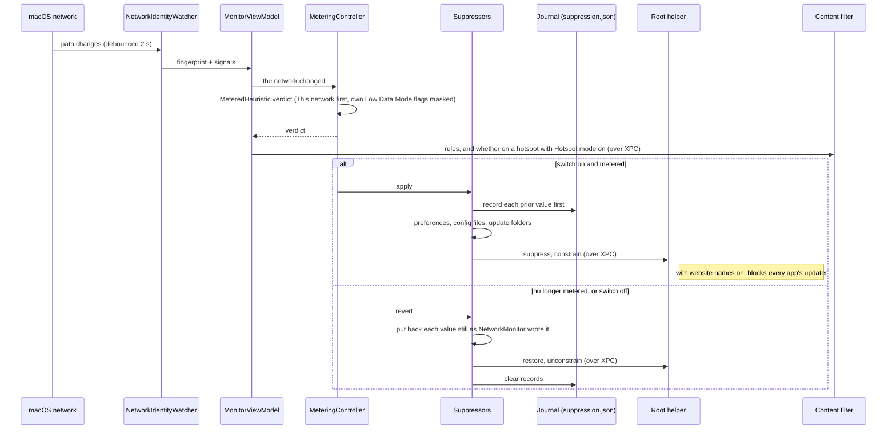

# Hotspot mode

One switch, in **Settings › Hotspot**: **Stop apps updating on hotspots**. Turn it on and
NetworkMonitor switches off automatic updates whenever you're on a mobile hotspot, then
switches them back on when you leave. Apps keep working normally: Chrome still browses,
Slack still messages, VS Code still edits. They just don't download new versions of
themselves while you're paying by the gigabyte. There's nothing to configure and no list
to maintain. It's off until you turn it on.

## When you turn it on

Installing NetworkMonitor doesn't look at your other apps or change anything. Hotspot mode
is off, and only the traffic counting runs. When you switch it on:

1. **macOS asks you to allow a small helper, once:** switch on NetworkMonitor in System
   Settings › General › Login Items & Extensions, under **Allow in the Background**
   (#131). macOS may ask for your password or Touch ID to allow it; NetworkMonitor itself
   never does. It's optional; see [what it pauses](#what-it-pauses) for what it adds.
2. **NetworkMonitor looks inside the apps** in `/Applications` and `~/Applications` to see
   how each one updates. It reads their files on your Mac; there's no list downloaded from
   anywhere.
3. **Settings › Hotspot shows two lists:**
   - **Paused on a hotspot:** every app it can pause, one line each with a switch to leave
     it alone. How it's paused is behind an ⓘ beside the name.
   - **Can't be paused:** every app it can't, with the reason behind the same ⓘ.
4. **Nothing changes until you join a hotspot.** Then everything on the first list is
   paused, and it's all put back when you leave.

The lists are made again each time you open the pane, so an app you install later shows up.

## What counts as a hotspot

The first of these that applies decides. Every check is unprivileged, and **Settings ›
Hotspot › Right now** always says which one fired.

1. **You said so.** **Settings › Hotspot › This network** is *Detect automatically* until
   you choose *Is a hotspot* or *Isn't a hotspot*, which is remembered for that network
   and beats everything below.
2. **macOS says so.** It marks a connection as expensive, as it does for an iPhone
   hotspot it recognises.
3. **An Android phone says so.** Android's hotspot and USB tethering mark every address
   they hand out as metered, in the DHCP reply: vendor option 43, `ANDROID_METERED`.
   macOS ignores it; NetworkMonitor reads it from configd's copy of the lease (#109).
4. **The router looks like an iPhone's Personal Hotspot**: its address is in
   `172.20.10.0/28`.
5. **The router looks like an older Android phone sharing its connection**:
   `192.168.42.0/24` or `192.168.43.0/24`. Newer ones pick a random subnet, which is
   why 3 comes first.
6. **You're tethered through a phone over USB**: the interface's name contains *iPhone*,
   *iPad*, *Android*, *RNDIS* or *USB tether*.
7. **The connection is in Low Data Mode**, which you can set for any network in System
   Settings, such as a capped home line or hotel Wi-Fi.

Everything after 3 is convention, so it fails safe: a miss means updates aren't paused,
never that your home network is treated as a hotspot, and *This network* settles any
miss. The popover shows an orange **METERED** badge beside the total whenever a
connection counts.

## What it pauses

**Without a password:**

| App | What changes |
|---|---|
| Any app that updates with Sparkle (VLC, AppCleaner, ChatGPT, Affinity, VoiceInk and others), found by looking inside each app | its `SUEnableAutomaticChecks` setting |
| Google Chrome, where Google's older updater (Keystone) still runs | Keystone's `checkInterval` |
| Microsoft AutoUpdate, which updates Microsoft's Mac apps | `HowToCheck`, set to Manual |
| Figma | `DisableUpdater` |
| Visual Studio Code | `"update.mode": "none"` in its `settings.json` |
| Claude | `disableAutoUpdates` in its app configuration |
| Any Electron app that updates with Squirrel or electron-updater (Slack, Claude, Figma, VS Code, Granola, Synergy and others), found by looking inside each app, **even while it's open** | the folder its updates download to is made read-only |

Settings only take effect when an app starts, so an app that was already open when you
joined the hotspot would still update. Electron apps can't: Squirrel makes a folder for the
download in `~/Library/Caches/<app>.ShipIt` before it fetches anything, and
electron-updater writes to `~/Library/Caches/<its cache>` first, so with those folders
read-only the download never starts. A folder that isn't there yet is made read-only, and
removed again when you leave. An update that has already downloaded is left to install:
its folder isn't locked. Each folder goes back to exactly how it was, and one whose
permissions someone else changed meanwhile is left alone.

**With your OK, once.** Switching Hotspot mode on offers a small helper, which macOS lists
under NetworkMonitor in Login Items for you to switch on. With it, the switch also covers:

- **macOS software updates and App Store updates.** These are by far the largest, often
  6 to 14 GB, and live in settings only an administrator can change.
- **Claude and Slack** through managed policy, which is the only kind of setting they
  fully honour.
- **Claude Code** through its managed settings: a file of NetworkMonitor's own in
  `/Library/Application Support/ClaudeCode/managed-settings.d` that sets
  `DISABLE_AUTOUPDATER`. It covers every account on the Mac, and `claude update` still
  works.
- **Canva**, which has no update setting of any kind, and **Figma** while it's open, since
  its own setting can only be changed once it quits: while you're on the hotspot, their
  update servers are pointed nowhere in `/etc/hosts`. Each of those two hosts was checked
  to carry update downloads and nothing else.
- **Google Chrome**, and its Beta, Dev and Canary channels, wherever Google's newer updater
  (GoogleUpdater) has replaced Keystone. It reads no setting NetworkMonitor can change
  unless your Mac is managed by an organisation, so its update check,
  `update.googleapis.com`, is pointed nowhere too. That host only answers update checks;
  the downloads come from shared servers that stay open.
- **Low Data Mode** for the hotspot (below).

Leave it off and everything else still works. Settings shows an **Allow…** button for when
you change your mind, and the step in System Settings while it waits. The helper is part of
the app, so a new version brings its helper with it and asks nothing.

Each app has its own switch under **Paused on a hotspot**, on the same line as its name,
if you want to leave one alone. Point at the row and an ⓘ appears beside the name: it says
how the app is paused, such as *Turns off its automatic update check* or *Blocks its update
server*, as a tooltip or, clicked, in a popover (#185). What the helper pauses shares one
switch, **Through NetworkMonitor's helper**, because the helper does it all at once; it
names only what's on your Mac, and its ⓘ says how each is paused. The Electron apps share
one too, **Through their update folders**. On a hotspot, an app that's open when its setting needs changing is marked
*paused once you quit it*, and the change is made the moment it quits, because apps write
their settings back when they quit. Off a hotspot nothing is waiting, so nothing is marked.

## Low Data Mode, for the apps no setting reaches

The lists above only cover apps whose update setting NetworkMonitor knows, and your Mac
has apps it doesn't. So with the helper installed, the same switch also puts the hotspot
in **Low Data Mode**, the flag macOS sets itself on an iPhone hotspot it recognises.
Everything that listens for it holds back: iCloud and Photos sync, background downloads
macOS schedules, and any app that respects Low Data Mode, whether NetworkMonitor has heard
of it or not.

- **It's a flag on the connection, not a setting saved anywhere.** Nothing is written to
  disk, your own Low Data Mode choices in System Settings are left alone, and a restart
  clears it whatever happens.
- **It only takes down what it put up.** If macOS or you had already turned it on for a
  connection, it stays on when you leave.
- **It's switched off when you leave the hotspot, and when you quit.** It affects the whole
  Mac, so it never stays behind on home Wi-Fi with nothing watching.
- **Settings shows whether it worked.** It reads the connection back, and says *macOS
  confirms it* once macOS itself reports the connection as constrained. If macOS keeps
  switching it off, NetworkMonitor stops after three tries in five minutes and says so,
  rather than fighting it.
- **Most Electron apps ignore it.** Chromium's networking doesn't listen for Low Data Mode.

## What isn't covered, and what got through anyway

**Can't be paused** in Settings lists the apps on *your* Mac that update themselves in a
way NetworkMonitor can't switch off, each with the reason:

| The reason it gives | What's behind it |
|---|---|
| *Updates from inside the app, with no setting NetworkMonitor can turn off* | an Electron app whose download folder NetworkMonitor can't tell, such as an electron-updater app that doesn't name its cache |
| *Has its own updater, with no setting NetworkMonitor can turn off* | a separate updater program in the app, such as Opera's or Raycast's |
| *macOS keeps its update setting where NetworkMonitor can't change it* | a sandboxed Sparkle app, whose settings live in its container |
| *Paused once you allow the helper below* | an app the helper covers, such as Slack, before the helper is installed |

They're found by how they update, not by a list of names, so the list matches what you
actually have installed. Low Data Mode slows the ones that respect it; quitting them while
you're on a hotspot is the only sure way.

While you're on a metered connection, NetworkMonitor also notices **updates that get
through anyway**, by three signs:

- a file over 1 MB appearing where Electron and Sparkle apps stage their downloads, or
  where Claude Code downloads and keeps its versions (`~/.cache/claude/staging` and
  `~/.local/share/claude/versions`);
- a program named like an updater using the connection, named for the app it updates:
  *Google Chrome*, not *GoogleUpdater* (#94);
- an app in Applications whose version changes, however it got the update (#94).

The popover shows one line under the total when that happens, and Settings lists each one
with the data it used and the version it updated to, still there after you've left the
hotspot. An app that was on the paused list says it **updated anyway**, in orange, both
there and beside its switch, until the next metered connection: that's how a pause that
didn't hold is found. Each one also stays in [Usage History](usage-history.md#sessions),
with the visit it happened on (#96).

**The data an update used** is its app's traffic while it downloaded: from when the
updater created its download, or when you joined the hotspot if that was later, to its
last change, counted by the minute. It's not the size of what's left behind, which is the
unpacked update: Slack's read 271.6 MB when Slack used about 120 MB (#95). When the app's
traffic wasn't seen, because NetworkMonitor was started mid-download, the size on disk is
shown as **up to**, since a download is smaller than what it unpacks to. An updater
program of its own is counted by its own traffic.

## Three things worth knowing

- **It's mostly not a firewall.** For almost every app it changes the app's own setting
  for checking automatically, so a manual **Check for Updates…** still works, which is the
  point: it stops unattended downloads, not you. The exceptions block instead, so a manual
  check waits until you leave: with the helper, Canva's, Figma's and Chrome's update
  servers; Electron apps whose update folder is locked; and, with website names on, every
  app's updater program (#98), unless you **Always Allow** it in Connections. Nothing ever
  interrupts an update already downloading.
- **"Stops updating" includes security updates.** There's no reliable way to tell a
  security patch from a feature release, and pretending otherwise would be worse than
  saying so. Turn the switch off, or leave the hotspot, and everything resumes.
- **Uninstall from the app, not by dragging it to the Trash.** See
  [installing](installing.md#uninstall) for why.

## How it's built

**Policy and enforcement are separate.** `MeteringController` decides; five conformers
of the `UpdateSuppressor` protocol (`discover`, `apply`, `revert`) carry it out:

| Suppressor | Covers | Needs the helper |
|---|---|---|
| `PreferenceSuppressor` | Sparkle apps, Chrome, Microsoft AutoUpdate, Figma | no |
| `ConfigFileSuppressor` | VS Code, Claude | no |
| `UpdateFolderSuppressor` | Electron apps' update folders (Squirrel, electron-updater) | no |
| `PrivilegedSuppressor` | macOS and App Store updates, managed policies, Claude Code's managed settings, `/etc/hosts` entries | yes |
| `LowDataModeSuppressor` | interface flags | yes |

Stopping every app's updater at the network (#98) isn't one of them. The content filter
does it, from the rules and the hotspot state the app sends it, so it needs website names
on; see [Connections › Blocking](connections.md#blocking).

**It only acts on events:** launch, a network change, the switch, a per-app switch, an app
quitting with a queued change, Settings opening, and the helper being installed. There's no
timer. Offline is ignored: a dropped connection neither lifts nor applies anything.

**Detection** lives in `MeteredHeuristic.swift`. The verdict is an enum, not a Bool, so the
UI can say *why*. The flags NetworkMonitor raised itself for Low Data Mode are masked out
first; otherwise leaving a hotspot for home Wi-Fi on the same interface would judge home
metered by our own flags and hold them forever. *This network* in Settings › Hotspot stores
a per-network override (`meteredOverrides` in `usage.json`), which beats every signal (#109).

**Writing other apps' settings:**

- Preferences are written with `CFPreferences`, and only the *check* flag. Sandboxed apps
  are skipped, since a write from outside lands in a file they never read. A setting that
  already has the suppressed value is the user's own choice and is never recorded, so it's
  never "restored" to something else.
- `settings.json` is edited as text, inserting or removing one line, because VS Code's file
  allows comments and trailing commas that a JSON round trip would destroy. A value the user
  set themselves is left alone.
- Apps are found in `/Applications` and `~/Applications`, and named apps are looked up
  through LaunchServices, then checked on disk, because LaunchServices remembers deleted
  apps.

**The journal** (`~/Library/Application Support/NetworkMonitor/suppression.json`) records
each prior value **before** the change is made, with a backup copy. A value is only put back
if it still holds what NetworkMonitor wrote; if you changed it since, yours stays. At launch
the journal is replayed (restore everything), then the connection re-evaluated, then
re-applied if still metered. The failure this protects against is a Mac that silently
stopped updating months ago.

Suppression is **not** lifted on quit: quitting isn't "resume updating", since you might
quit to save battery mid-hotspot, and the journal makes leaving it safe. Low Data Mode is
the exception, because it's machine-wide and nothing would lift it otherwise.

### The helper

A small root binary with a **fixed, argument-free vocabulary**. Every preference key,
domain and host name is compiled in, so the app (the side an attacker could reach) can't
ask for anything else; adding a capability means shipping a new helper.

| Verb | Does | Who can run it |
|---|---|---|
| `status` | reports what it holds, as JSON, with its version | NetworkMonitor, over XPC |
| `suppress` / `restore` | the system update settings, managed policies, Claude Code's managed settings and `/etc/hosts` entries | NetworkMonitor, over XPC |
| `constrain` / `unconstrain` | raises or lowers Low Data Mode on the interface carrying traffic, which it picks itself | NetworkMonitor, over XPC |
| `self-heal` | if `/Applications/NetworkMonitor.app` is gone, undoes everything and removes itself | launchd, as root |
| `uninstall` | undoes everything and removes itself | NetworkMonitor's Uninstall, over XPC |

**A launch daemon inside the app** (#131). The app registers it with `SMAppService`
(`Contents/Library/LaunchDaemons/com.kevinabouhanna.NetworkMonitor.daemon.plist`), macOS
lists it under NetworkMonitor in Login Items, and once you switch it on launchd starts it on
the app's first request. It answers over XPC, only to NetworkMonitor signed by its team
(GRQKG7M8CL), and the app only talks to the helper signed by that team. Each request runs
the same binary with the one verb, so a verb behaves exactly as it did under `sudo`; it
quits when idle, so an updated app's helper is the one that answers. On first start it:

- removes the old sudoers rule, if there is one;
- copies itself to `/Library/PrivilegedHelperTools/com.kevinabouhanna.NetworkMonitor.helper`
  and installs the hourly `self-heal` job. Dragging the app to the Trash takes the daemon
  with it, since its program is inside the app and macOS doesn't unregister it, so the
  copy is what still puts everything back. The job is listed under NetworkMonitor too
  (`AssociatedBundleIdentifiers`).

**Builds without a Developer ID**, built from source, have no team to check callers by, so
they keep the older way: installed through macOS's administrator dialog, running the
`helper-setup.sh` inside the bundle. It installs:

- the binary at `/Library/PrivilegedHelperTools/com.kevinabouhanna.NetworkMonitor.helper`,
  owned by root (a password-free rule pointing at a binary you could rewrite would be a
  one-line route to root);
- a sudoers rule, `/etc/sudoers.d/networkmonitor`, allowing exactly five of the verbs
  above for your account, `status`, `suppress`, `restore`, `constrain` and `unconstrain`,
  validated with `visudo -c` first. Its name has no dot, because sudo
  skips files whose names contain one;
- a LaunchDaemon that runs `self-heal` at boot and every hour. It's the extra row in
  Login Items.

The app calls it with `sudo -n`, which fails immediately instead of prompting if anything
is wrong. The helper's own records live in `/Library/Application Support/NetworkMonitor/`,
are trusted only if root-owned and not writable by others, and a damaged one is an error,
never "nothing to restore". Every verb takes a lock and fails fast if another is running.

**Why those builds use `sudo`.** Authorising an XPC client needs a team identifier, which an
ad-hoc signature doesn't have. Without one, an XPC daemon is a service any local process can
talk to. A sudoers rule makes the grant explicit and auditable instead.

**Versioning.** `HelperProtocol.version` (now 5, for `serve`) lives in the `LowDataMode`
target that the app and the helper share. For the daemon it hardly matters: the helper is
inside the app, so they're always the same version. For `sudo` helpers, bump it when a verb
is added or changed, or the sudoers rule changes, and installed helpers are offered an
update once per build; a `sudo` helper on a Developer ID build is offered the daemon
instead.

### Low Data Mode internals

The helper raises the interface's `constrained` and `expensive` flags with `ifconfig`.
`constrained` is what `NWPath.isConstrained` reports and what apps opting out of
constrained networks are held to. Writing System Settings' own Low Data Mode setting was
the original plan and was rejected: it reached wired connections only, because Wi-Fi keeps
Low Data Mode per network in a file only `wifid` writes. Flags work the same for Wi-Fi, USB
iPhone and Android tethering, and vanish at restart.

The helper picks the interface carrying traffic from `scutil --nwi`, skipping VPN
tunnels, and records which flags it raised (`low-data-mode.json`) before raising them. On
the way down it lowers only those, and leaves `constrained` up on a wired connection you
put in Low Data Mode yourself.

### Uninstalling, in order

The in-app **Uninstall…** removes the helper first, and if that fails nothing else is
touched. With the daemon it asks nothing: the daemon puts everything back, removes its copy,
the self-heal job and any sudoers rule, and then the app unregisters it. A `sudo` helper
asks for your password, and cancelling leaves everything as it was. Then it replays the journal,
withdraws the login item, deletes `~/Library/Application Support/NetworkMonitor` and the
app's preferences, and moves the app to the Trash, where you can still drag it back.

Dragging the app to the Trash instead leaves the password-free changes in place, because
their only record is the app's journal. The helper's hourly check covers its own changes.
`make metering-report` shows what's held on a Mac at any moment, read-only.

## Known gaps

- **Updaters compiled into an app's own binary** (Tauri apps, for example) can't be found
  by their shape.
- **Electron apps with an updater of their own**, neither Squirrel nor electron-updater,
  are only slowed by Low Data Mode if they respect it, and most don't. With website names
  on, the content filter stops an updater that runs as a program of its own (#98), but not
  one that downloads from inside the app itself.
- **Sparkle apps that were open when you joined the hotspot** keep their setting until they
  quit, so one could still update; Settings marks them *paused once you quit it*.
- **Claude Code in an organisation that manages it.** If your organisation sends Claude Code
  settings from its servers or through MDM, Claude Code may use those instead of
  NetworkMonitor's file, and keep updating.
- **A phone whose maker replaced Android's tethering** may not say it's a hotspot, and
  may use a subnet nobody can guess. Choose *Is a hotspot* under *This network*, once.
