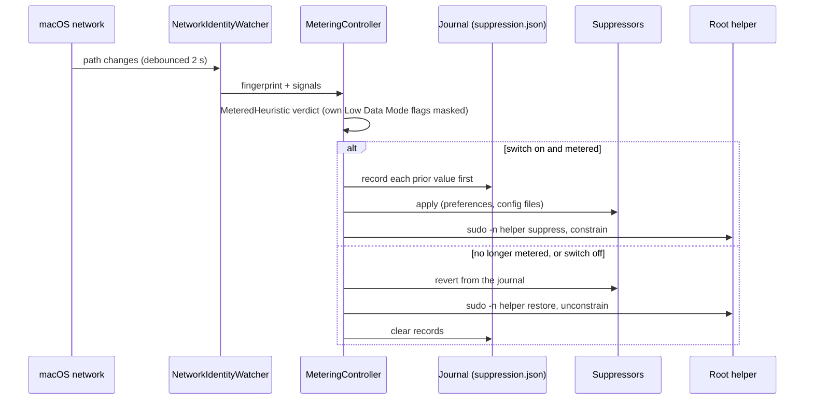

# Hotspot mode

One switch, in **Settings › Hotspot**: **Stop apps updating on hotspots**. Turn it on and
NetworkMonitor switches off automatic updates whenever you're on a mobile hotspot, then
switches them back on when you leave. Apps keep working normally: Chrome still browses,
Slack still messages, VS Code still edits. They just don't download new versions of
themselves while you're paying by the gigabyte. There's nothing to configure and no list
to maintain. It's off until you turn it on.

## When you turn it on

Installing NetworkMonitor doesn't look at your other apps or change anything. Hotspot mode
is off, and only the traffic counting runs. When you switch it on:

1. **macOS asks for your password, once,** to install a small helper. It's optional; see
   [what it pauses](#what-it-pauses) for what it adds.
2. **NetworkMonitor looks inside the apps** in `/Applications` and `~/Applications` to see
   how each one updates. It reads their files on your Mac; there's no list downloaded from
   anywhere.
3. **Settings › Hotspot shows two lists:**
   - **Paused on a hotspot:** every app it can pause, each with a line saying how, and a
     switch to leave it alone.
   - **Can't be paused:** every app it can't, each with the reason.
4. **Nothing changes until you join a hotspot.** Then everything on the first list is
   paused, and it's all put back when you leave.

The lists are made again each time you open the pane, so an app you install later shows up.

## What counts as a hotspot

The first of these that applies decides. Every check is unprivileged, and **Settings ›
Hotspot › Right now** always says which one fired.

1. **macOS says so.** It marks a connection as expensive, as it does for an iPhone
   hotspot it recognises.
2. **The router looks like an iPhone's Personal Hotspot**: its address is in
   `172.20.10.0/28`.
3. **The router looks like an Android phone sharing its connection**: `192.168.42.0/24`
   or `192.168.43.0/24`.
4. **You're tethered through a phone over USB**: the interface's name contains *iPhone*,
   *iPad*, *Android*, *RNDIS* or *USB tether*.
5. **The connection is in Low Data Mode**, which you can set for any network in System
   Settings, such as a capped home line or hotel Wi-Fi.

These are conventions, so they fail safe: a miss means updates aren't paused, never that
your home network is treated as a hotspot. The popover shows an orange **METERED** badge
beside the total whenever a connection counts.

## What it pauses

**Without a password:**

| App | What changes |
|---|---|
| Any app that updates with Sparkle (VLC, AppCleaner, ChatGPT, Affinity, VoiceInk and others), found by looking inside each app | its `SUEnableAutomaticChecks` setting |
| Google Chrome, where Google's older updater (Keystone) still runs | Keystone's `checkInterval` |
| Microsoft AutoUpdate, which updates Microsoft's Mac apps | `HowToCheck`, set to Manual |
| Figma | `DisableUpdater` |
| Visual Studio Code | `"update.mode": "none"` in its `settings.json` |
| Claude | `disableAutoUpdates` in its app configuration |

**With your password, once.** Switching Hotspot mode on offers to install a small helper.
With it, the switch also covers:

- **macOS software updates and App Store updates.** These are by far the largest, often
  6 to 14 GB, and live in settings only an administrator can change.
- **Claude and Slack** through managed policy, which is the only kind of setting they
  fully honour.
- **Claude Code** through its managed settings: a file of NetworkMonitor's own in
  `/Library/Application Support/ClaudeCode/managed-settings.d` that sets
  `DISABLE_AUTOUPDATER`. It covers every account on the Mac, and `claude update` still
  works.
- **Canva**, which has no update setting of any kind, and **Figma** while it's open, since
  its own setting can only be changed once it quits: while you're on the hotspot, their
  update servers are pointed nowhere in `/etc/hosts`. Each of those two hosts was checked
  to carry update downloads and nothing else.
- **Google Chrome**, wherever Google's newer updater (GoogleUpdater) has replaced Keystone.
  It reads no setting NetworkMonitor can change unless your Mac is managed by an
  organisation, so its update check, `update.googleapis.com`, is pointed nowhere too. That
  host only answers update checks; the downloads come from shared servers that stay open.
- **Low Data Mode** for the hotspot (below).

Cancel the password prompt and everything else still works. Settings shows an **Allow…**
button for when you change your mind. If a new version of NetworkMonitor needs a newer
helper, it asks once more, the first time it opens.

Each app has its own switch under **Paused on a hotspot**, if you want to leave one alone,
and a line saying how it's paused, such as *Turns off its automatic update check* or
*Blocks its update server*. What the helper pauses shares one switch, **Through
NetworkMonitor's helper**, because the helper does it all at once; it lists only what's on
your Mac. On a hotspot, an app that's open when its setting needs changing is marked
*paused once you quit it*, and the change is made the moment it quits, because apps write
their settings back when they quit. Off a hotspot nothing is waiting, so nothing is marked.

## Low Data Mode, for the apps no setting reaches

The lists above only cover apps whose update setting NetworkMonitor knows, and your Mac
has apps it doesn't. So with the helper installed, the same switch also puts the hotspot
in **Low Data Mode**, the flag macOS sets itself on an iPhone hotspot it recognises.
Everything that listens for it holds back: iCloud and Photos sync, background downloads
macOS schedules, and any app that respects Low Data Mode, whether NetworkMonitor has heard
of it or not.

- **It's a flag on the connection, not a setting saved anywhere.** Nothing is written to
  disk, your own Low Data Mode choices in System Settings are left alone, and a restart
  clears it whatever happens.
- **It only takes down what it put up.** If macOS or you had already turned it on for a
  connection, it stays on when you leave.
- **It's switched off when you leave the hotspot, and when you quit.** It affects the whole
  Mac, so it never stays behind on home Wi-Fi with nothing watching.
- **Settings shows whether it worked.** It reads the connection back, and says *macOS
  confirms it* once macOS itself reports the connection as constrained. If macOS keeps
  switching it off, NetworkMonitor stops after three tries in five minutes and says so,
  rather than fighting it.
- **Most Electron apps ignore it.** Chromium's networking doesn't listen for Low Data Mode.

## What isn't covered, and what got through anyway

**Can't be paused** in Settings lists the apps on *your* Mac that update themselves in a
way NetworkMonitor can't switch off, each with the reason:

| The reason it gives | What's behind it |
|---|---|
| *Updates from inside the app, with no setting NetworkMonitor can turn off* | an Electron app's updater (Squirrel or electron-updater), which runs inside the app itself |
| *Has its own updater, with no setting NetworkMonitor can turn off* | a separate updater program in the app, such as Opera's or Raycast's |
| *macOS keeps its update setting where NetworkMonitor can't change it* | a sandboxed Sparkle app, whose settings live in its container |
| *Paused once you allow the helper below* | an app the helper covers, such as Slack, before the helper is installed |

They're found by how they update, not by a list of names, so the list matches what you
actually have installed. Low Data Mode slows the ones that respect it; quitting them while
you're on a hotspot is the only sure way.

While you're on a metered connection, NetworkMonitor also notices **updates that download
anyway**: a file over 1 MB appearing where Electron and Sparkle apps stage their downloads,
or a program named like an updater using the connection. The popover shows one line under
the total when that happens, and Settings lists each one with its size, still there after
you've left the hotspot.

## Three things worth knowing

- **It's not a firewall.** For almost every app it changes the app's own setting for
  checking automatically, so a manual **Check for Updates…** still works, which is the
  point: it stops unattended downloads, not you. Canva, Figma and Chrome are the exception:
  with the helper, their update servers can't be reached while you're on the hotspot, so a
  manual check in those three waits until you leave. Nothing ever interrupts an update
  already downloading.
- **"Stops updating" includes security updates.** There's no reliable way to tell a
  security patch from a feature release, and pretending otherwise would be worse than
  saying so. Turn the switch off, or leave the hotspot, and everything resumes.
- **Uninstall from the app, not by dragging it to the Trash.** See
  [installing](installing.md#uninstall) for why.

## How it's built

**Policy and enforcement are separate.** `MeteringController` decides; four conformers
of the `UpdateSuppressor` protocol (`discover`, `apply`, `revert`) carry it out:

| Suppressor | Covers | Needs the helper |
|---|---|---|
| `PreferenceSuppressor` | Sparkle apps, Chrome, Microsoft AutoUpdate, Figma | no |
| `ConfigFileSuppressor` | VS Code, Claude | no |
| `PrivilegedSuppressor` | macOS and App Store updates, managed policies, Claude Code's managed settings, `/etc/hosts` entries | yes |
| `LowDataModeSuppressor` | interface flags | yes |

A content-filter tier could be added later as one more conformer, without touching policy,
journal or UI. It would need a Developer ID.

**It only acts on events:** launch, a network change, the switch, a per-app switch, an app
quitting with a queued change, Settings opening, and the helper being installed. There's no
timer. Offline is ignored: a dropped connection neither lifts nor applies anything.

**Detection** lives in `MeteredHeuristic.swift`. The verdict is an enum, not a Bool, so the
UI can say *why*. The flags NetworkMonitor raised itself for Low Data Mode are masked out
first; otherwise leaving a hotspot for home Wi-Fi on the same interface would judge home
metered by our own flags and hold them forever. The code can store a per-network override
(`meteredOverrides` in `usage.json`), but nothing in the app sets it yet.

**Writing other apps' settings:**

- Preferences are written with `CFPreferences`, and only the *check* flag. Sandboxed apps
  are skipped, since a write from outside lands in a file they never read. A setting that
  already has the suppressed value is the user's own choice and is never recorded, so it's
  never "restored" to something else.
- `settings.json` is edited as text, inserting or removing one line, because VS Code's file
  allows comments and trailing commas that a JSON round trip would destroy. A value the user
  set themselves is left alone.
- Apps are found in `/Applications` and `~/Applications`, and named apps are looked up
  through LaunchServices, then checked on disk, because LaunchServices remembers deleted
  apps.

**The journal** (`~/Library/Application Support/NetworkMonitor/suppression.json`) records
each prior value **before** the change is made, with a backup copy. A value is only put back
if it still holds what NetworkMonitor wrote; if you changed it since, yours stays. At launch
the journal is replayed (restore everything), then the connection re-evaluated, then
re-applied if still metered. The failure this protects against is a Mac that silently
stopped updating months ago.

Suppression is **not** lifted on quit: quitting isn't "resume updating", since you might
quit to save battery mid-hotspot, and the journal makes leaving it safe. Low Data Mode is
the exception, because it's machine-wide and nothing would lift it otherwise.

### The helper

A small root binary with a **fixed, argument-free vocabulary**. Every preference key,
domain and host name is compiled in, so the app (the side an attacker could reach) can't
ask for anything else; adding a capability means shipping a new helper.

| Verb | Does | Who can run it |
|---|---|---|
| `status` | reports what it holds, as JSON, with its version | you, without a password |
| `suppress` / `restore` | the system update settings, managed policies, Claude Code's managed settings and `/etc/hosts` entries | you, without a password |
| `constrain` / `unconstrain` | raises or lowers Low Data Mode on the interface carrying traffic, which it picks itself | you, without a password |
| `self-heal` | if `/Applications/NetworkMonitor.app` is gone, undoes everything and removes itself | launchd, as root |
| `uninstall` | undoes everything and removes itself | the uninstaller, as root |

**Installed by the app**, through macOS's standard administrator dialog, running the
`helper-setup.sh` inside the bundle. It installs:

- the binary at `/Library/PrivilegedHelperTools/com.kevinabouhanna.NetworkMonitor.helper`,
  owned by root (a password-free rule pointing at a binary you could rewrite would be a
  one-line route to root);
- a sudoers rule, `/etc/sudoers.d/networkmonitor`, allowing exactly the five verbs above
  for your account, validated with `visudo -c` first. Its name has no dot, because sudo
  skips files whose names contain one;
- a LaunchDaemon that runs `self-heal` at boot and every hour. It's the extra row in
  Login Items.

The app calls it with `sudo -n`, which fails immediately instead of prompting if anything
is wrong. The helper's own records live in `/Library/Application Support/NetworkMonitor/`,
are trusted only if root-owned and not writable by others, and a damaged one is an error,
never "nothing to restore". Every verb takes a lock and fails fast if another is running.

**Why not `SMAppService.daemon` and XPC?** Authorising an XPC client needs a team
identifier, which an ad-hoc signature doesn't have. Without one, an XPC daemon is a service
any local process can talk to, plus hundreds of lines buying no enforceable security. A
sudoers rule makes the grant explicit and auditable. This, the password prompt and the
extra Login Items row all reverse once there's a Developer ID; see the
[roadmap](roadmap.md).

**Versioning.** `HelperProtocol.version` (now 4) lives in the `LowDataMode` target that the
app and the helper share. Bump it when a verb is added or changed, or the sudoers rule
changes, and installed helpers are offered an update once per build. Otherwise an app
update never asks for a password.

### Low Data Mode internals

The helper raises the interface's `constrained` and `expensive` flags with `ifconfig`.
`constrained` is what `NWPath.isConstrained` reports and what apps opting out of
constrained networks are held to. Writing System Settings' own Low Data Mode setting was
the original plan and was rejected: it reached wired connections only, because Wi-Fi keeps
Low Data Mode per network in a file only `wifid` writes. Flags work the same for Wi-Fi, USB
iPhone and Android tethering, and vanish at restart.

The helper picks the interface carrying traffic from `scutil --nwi`, skipping VPN
tunnels, and records which flags it raised (`low-data-mode.json`) before raising them. On
the way down it lowers only those, and leaves `constrained` up on a wired connection you
put in Low Data Mode yourself.

### Uninstalling, in order

The in-app **Uninstall…** removes the helper first, because that's the only step you can
cancel, and if it's cancelled or fails nothing else is touched. Then it replays the journal,
withdraws the login item, deletes `~/Library/Application Support/NetworkMonitor` and the
app's preferences, and moves the app to the Trash, where you can still drag it back.

Dragging the app to the Trash instead leaves the password-free changes in place, because
their only record is the app's journal. The helper's hourly check covers its own changes.
`make metering-report` shows what's held on a Mac at any moment, read-only.

## Known gaps

- **Updaters compiled into an app's own binary** (Tauri apps, for example) can't be found
  by their shape.
- **Electron apps without a setting** are only slowed by Low Data Mode if they respect it,
  and most don't. A content filter would cover them, but needs a Developer ID.
- **There's no way yet to mark a network as metered by hand.** Putting it in Low Data Mode
  in System Settings has the same effect.
