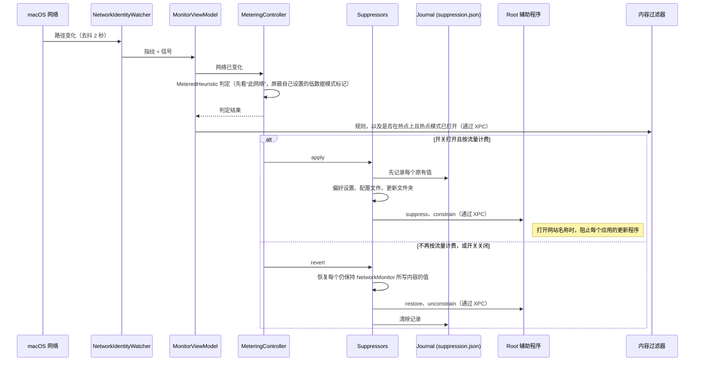

# 热点模式

[English](../hotspot-mode.md) · 简体中文

只有一个开关，在 <strong>设置 › 热点</strong> 中：<strong>停止热点下的应用更新</strong>。打开后，只要你在使用移动热点，NetworkMonitor 就会关闭自动更新，离开热点后再重新打开。应用照常工作：Chrome 照样浏览网页，Slack 照样收发消息，VS Code 照样编辑。只是在你按 GB 付费时，它们不会下载自己的新版本。没有需要配置的东西，也没有需要维护的列表。在你打开它之前，它是关闭的。

## 打开之后

安装 NetworkMonitor 不会查看你的其他应用，也不会更改任何东西。热点模式默认关闭，只运行流量统计。打开它时：

1. <strong>macOS 会请你允许一个小型辅助程序，只需一次：</strong> 在“系统设置 › 通用 › 登录项与扩展”中，在 <strong>允许在后台</strong> 下打开 NetworkMonitor（#131）。macOS 可能会要求你输入密码或使用触控 ID 来允许它；NetworkMonitor 本身从不要求。这一步是可选的；它增加了哪些功能，请参阅[它会暂停什么](#它会暂停什么)。
2. <strong>NetworkMonitor 会查看</strong> `/Applications` 和 `~/Applications` 中的应用内部，了解每个应用如何更新。它读取的是你 Mac 上的应用文件，不会从任何地方下载列表。
3. <strong>设置 › 热点会显示两个列表：</strong>
   - <strong>使用热点时暂停：</strong> 它能暂停的每个应用，每个一行，并有一个开关，可以让它不去管这个应用。如何暂停写在名称旁的 ⓘ 后面。
   - <strong>不能暂停：</strong> 它不能暂停的每个应用，原因写在同样的 ⓘ 后面。
4. <strong>在你连接热点之前，什么都不会改变。</strong> 连接热点后，第一个列表上的所有应用都会暂停更新，离开时一切都会恢复原样。

每次打开这个面板，列表都会重新生成，所以你之后安装的应用也会出现在里面。

## 什么算作热点

以下条件按顺序检查，第一个符合的条件说了算。每项检查都不需要特权，<strong>设置 › 热点 › 当前</strong> 始终会说明是哪一项起了作用。

1. <strong>你自己说了算。</strong> <strong>设置 › 热点 › 此网络</strong> 默认是 *自动检测*，直到你选择 *是热点* 或 *不是热点*。你的选择会为该网络记住，并且优先于下面所有条件。
2. <strong>macOS 说是。</strong> macOS 把连接标记为昂贵，就像它对识别出的 iPhone 热点所做的那样。
3. <strong>Android 手机说是。</strong> Android 的热点和 USB 网络共享会在 DHCP 回复中把分配的每个地址标记为按流量计费：厂商选项 43，`ANDROID_METERED`。macOS 会忽略它；NetworkMonitor 从 configd 保存的租约副本中读取它（#109）。
4. <strong>路由器看起来像 iPhone 的个人热点</strong>：它的地址在 `172.20.10.0/28` 中。
5. <strong>路由器看起来像较旧的 Android 手机在共享网络</strong>：`192.168.42.0/24` 或 `192.168.43.0/24`。较新的手机会随机选择子网，这就是第 3 项排在前面的原因。
6. <strong>你通过 USB 用手机共享网络</strong>：网络接口的名称中包含 *iPhone*、*iPad*、*Android*、*RNDIS* 或 *USB tether*。
7. <strong>连接处于低数据模式</strong>。你可以在“系统设置”中为任何网络设置低数据模式，例如有流量上限的家庭宽带或酒店 Wi-Fi。

第 3 项之后的条件都只是惯例，所以出错时偏向安全：漏判只意味着更新没有暂停，绝不会把你的家庭网络当作热点，而且 *此网络* 可以纠正任何漏判。只要某个连接算作热点，弹出窗口就会在总量下方用橙色显示 *正在使用热点*。

这些检查只判断正在使用的连接。macOS 会让所有流量都走它排序最高的连接，所以插着以太网时连接热点，热点会处于空闲状态。这时弹出窗口和 *当前* 会说明热点已连接，但未在使用，流量用量、历史记录和暂停都仍跟随以太网。

## 它会暂停什么

<strong>无需密码：</strong>

| 应用 | 更改的内容 |
|---|---|
| 任何使用 Sparkle 更新的应用（VLC、AppCleaner、ChatGPT、Affinity、VoiceInk 等），通过查看每个应用的内部找到 | 它的 `SUEnableAutomaticChecks` 设置 |
| Google Chrome，在 Google 较旧的更新程序（Keystone）仍在运行的情况下 | Keystone 的 `checkInterval` |
| Microsoft AutoUpdate，负责更新 Microsoft 的 Mac 应用 | `HowToCheck`，设为 Manual |
| Figma | `DisableUpdater` |
| Visual Studio Code | 它的 `settings.json` 中的 `"update.mode": "none"` |
| Claude | 它的应用配置中的 `disableAutoUpdates` |
| 任何使用 Squirrel 或 electron-updater 更新的 Electron 应用（Slack、Claude、Figma、VS Code、Granola、Synergy 等），通过查看每个应用的内部找到，<strong>即使它正在运行</strong> | 它下载更新所用的文件夹被设为只读 |

设置只在应用启动时生效，所以在你连接热点时已经打开的应用仍可能更新。Electron 应用不会：Squirrel 在获取任何内容之前，会先在 `~/Library/Caches/<app>.ShipIt` 中创建下载用的文件夹，electron-updater 则会先写入 `~/Library/Caches/<its cache>`，因此这些文件夹设为只读后，下载根本不会开始。尚不存在的文件夹会被创建并设为只读，离开热点时再删除。已经下载完成的更新会照常安装：它的文件夹不会被锁定。每个文件夹都会完全恢复原样；如果在此期间有其他人更改了某个文件夹的权限，就不会去动它。

<strong>经你同意一次。</strong> 打开热点模式时，会提供一个小型辅助程序，macOS 会在“登录项”中的 NetworkMonitor 下列出它，供你打开。有了它，这个开关还会涵盖：

- <strong>macOS 软件更新和 App Store 更新。</strong> 这些更新是目前最大的，通常有 6 到 14 GB，而且相关设置只有管理员才能更改。
- <strong>Claude 和 Slack</strong>，通过托管策略，这是它们唯一完全遵循的设置。
- <strong>Claude Code</strong>，通过它的托管设置：NetworkMonitor 在 `/Library/Application Support/ClaudeCode/managed-settings.d` 中放一个自己的文件，设置 `DISABLE_AUTOUPDATER`。它适用于这台 Mac 上的所有帐户，`claude update` 仍然可用。
- <strong>Canva</strong>，它没有任何更新设置；以及正在运行的 <strong>Figma</strong>，因为它自己的设置只能在退出后更改：在你使用热点期间，它们的更新服务器会在 `/etc/hosts` 中指向空地址。这两个主机都经过检查，确认只承载更新下载，没有别的用途。
- <strong>Google Chrome</strong> 及其 Beta、Dev 和 Canary 版本，在 Google 较新的更新程序（GoogleUpdater）已取代 Keystone 的情况下。除非你的 Mac 由组织管理，否则它不读取任何 NetworkMonitor 能更改的设置，所以它的更新检查服务器 `update.googleapis.com` 也会被指向空地址。这个主机只响应更新检查；下载来自共享服务器，那些服务器保持畅通。
- 热点的 <strong>低数据模式</strong>（见下文）。

不打开它，其他一切照常工作。“设置”会显示一个 <strong>允许…</strong> 按钮，方便你改变主意，并在等待时显示“系统设置”中需要进行的步骤。辅助程序是应用的一部分，所以新版本会带来新的辅助程序，无需再次询问。

如果你想让某个应用不受影响，可以使用 <strong>使用热点时暂停</strong> 下每个应用自己的开关，它和应用名称在同一行。把指针移到这一行，名称旁会出现 ⓘ：它说明这个应用如何被暂停，例如 *关闭它的自动检查更新* 或 *阻止它的更新服务器*，以工具提示显示，点按后则显示在弹出窗口中（#185）。辅助程序暂停的内容共用一个开关 <strong>通过 NetworkMonitor 的辅助程序</strong>，因为辅助程序会一次性全部处理；它只列出你 Mac 上有的内容，它的 ⓘ 说明每一项如何被暂停。Electron 应用也共用一个开关：<strong>通过它们的更新文件夹</strong>。使用热点时，如果需要更改设置的应用正在运行，它会被标记为 *退出后暂停*，并在它退出的那一刻进行更改，因为应用会在退出时写回自己的设置。不在热点上时没有等待中的更改，所以不会有任何标记。

## 低数据模式：顾及没有设置可改的应用

上面的列表只涵盖 NetworkMonitor 知道其更新设置的应用，而你的 Mac 上还有它不知道的应用。所以安装辅助程序后，同一个开关还会让热点进入 <strong>低数据模式</strong>，也就是 macOS 在识别出 iPhone 热点时自己设置的那个标记。所有关注这个标记的东西都会收敛：iCloud 和“照片”同步、 macOS 安排的后台下载，以及任何遵循低数据模式的应用，无论 NetworkMonitor 是否知道它。

- <strong>它是连接上的一个标记，不是保存在某处的设置。</strong> 不会向磁盘写入任何内容，你自己在“系统设置”中的低数据模式选择不会被改动，而且无论发生什么，重新启动都会清除它。
- <strong>它只撤下自己设置的标记。</strong> 如果 macOS 或你已经为某个连接打开了低数据模式，离开时它会保持打开。
- <strong>离开热点时以及退出应用时，它会被关闭。</strong> 它影响整台 Mac，所以绝不会在没有人照看的情况下留在家里的 Wi-Fi 上。
- <strong>“设置”会显示它是否生效。</strong> 它会读回连接的状态，一旦 macOS 自己报告连接受限，就会显示 *macOS 已确认*。如果 macOS 不断关闭它，NetworkMonitor 会在五分钟内尝试三次后停止，并说明情况，而不是和 macOS 较劲。
- <strong>大多数 Electron 应用会忽略它。</strong> Chromium 的网络部分不关注低数据模式。

## 未涵盖的情况，以及仍然下载的更新

“设置”中的 <strong>不能暂停</strong> 列出了 *你的* Mac 上那些以 NetworkMonitor 无法关闭的方式自行更新的应用，并附上原因：

| 显示的原因 | 背后的情况 |
|---|---|
| *在应用内部更新，没有 NetworkMonitor 可以关闭的设置* | NetworkMonitor 无法判断其下载文件夹的 Electron 应用，例如没有说明缓存位置的 electron-updater 应用 |
| *有自己的更新程序，没有 NetworkMonitor 可以关闭的设置* | 应用中单独的更新程序，例如 Opera 或 Raycast 的更新程序 |
| *macOS 把它的更新设置存放在 NetworkMonitor 无法更改的地方* | 沙盒化的 Sparkle 应用，它的设置存放在自己的容器中 |
| *允许下方的辅助程序后即会暂停* | 辅助程序涵盖的应用，例如 Slack，在辅助程序安装之前 |

这些应用是根据更新方式找到的，而不是根据名称列表，所以列表和你实际安装的应用一致。低数据模式会让遵循它的应用放慢更新；使用热点时退出它们，才是唯一可靠的办法。

当你使用按流量计费的连接时，NetworkMonitor 还会通过三个迹象发现 <strong>仍然下载的更新</strong>：

- 在 Electron 和 Sparkle 应用存放下载的位置，或 Claude Code 下载和保存各个版本的位置（`~/.cache/claude/staging` 和 `~/.local/share/claude/versions`），出现超过 1 MB 的文件；
- 一个名称像更新程序的程序在使用连接，显示时用它所更新的应用来命名：*Google Chrome*，而不是 *GoogleUpdater*（#94）；
- “应用程序”中某个应用的版本发生变化，无论它是如何获得更新的（#94）。

发生这种情况时，弹出窗口会在总量下方显示一行，“设置”会列出每一个更新，以及它用掉的流量和更新到的版本，离开热点后仍会保留。原本在暂停列表中的应用，会在那里和它的开关旁用橙色标注 <strong>仍然更新了</strong>，直到下一次连接按流量计费的网络：这样就能发现没有生效的暂停。每一个更新也会保留在[流量历史](usage-history.md#连接时段)中，和它发生时的那次连接放在一起（#96）。

<strong>更新用掉的流量</strong> 是它的应用在下载期间的流量：从更新程序创建下载开始（如果你连接热点的时间更晚，则从连接热点开始），到最后一次变化为止，按分钟统计。它不是留下来的文件大小，那是解压后的更新：Slack 的更新显示为 271.6 MB，而 Slack 实际用了约 120 MB（#95）。如果没有看到应用的流量（因为 NetworkMonitor 是在下载中途启动的），就会把磁盘上的大小显示为 <strong>最多</strong>，因为下载的内容比解压后的要小。单独的更新程序按它自己的流量统计。

## 值得了解的三件事

- <strong>它基本上不是防火墙。</strong> 对几乎所有应用，它更改的是应用自己的自动检查设置，所以手动 <strong>检查更新…</strong> 仍然可用，这正是用意所在：它阻止的是无人值守的下载，而不是你。例外的情况是直接阻止，所以手动检查要等到你离开热点：有辅助程序时，Canva、Figma 和 Chrome 的更新服务器；更新文件夹被锁定的 Electron 应用；以及在打开网站名称时，每个应用的更新程序（#98），除非你在“连接”中对它选择 <strong>始终允许</strong>。任何情况下都不会打断已经在下载的更新。
- <strong>“停止更新”也包括安全更新。</strong> 没有可靠的方法区分安全补丁和功能更新，假装能做到比直说更糟。关闭开关，或者离开热点，一切都会恢复。
- <strong>请在应用内卸载，而不是把它拖到废纸篓。</strong> 原因请参阅[安装](installing.md#卸载)。

## 实现方式

<strong>决策和执行是分开的。</strong> `MeteringController` 负责决定；`UpdateSuppressor` 协议（`discover`、`apply`、`revert`）的五个实现负责执行：

| Suppressor | 涵盖 | 需要辅助程序 |
|---|---|---|
| `PreferenceSuppressor` | Sparkle 应用、Chrome、Microsoft AutoUpdate、Figma | 否 |
| `ConfigFileSuppressor` | VS Code、Claude | 否 |
| `UpdateFolderSuppressor` | Electron 应用的更新文件夹（Squirrel、electron-updater） | 否 |
| `PrivilegedSuppressor` | macOS 和 App Store 更新、托管策略、Claude Code 的托管设置、`/etc/hosts` 条目 | 是 |
| `LowDataModeSuppressor` | 网络接口标记 | 是 |

在网络层面阻止每个应用的更新程序（#98）不属于其中。这由内容过滤器完成，依据的是应用发给它的规则和热点状态，所以需要打开网站名称；请参阅[连接 › 阻止](connections.md#阻止)。

<strong>它只在事件发生时动作：</strong> 启动、网络变化、总开关、单个应用的开关、有排队更改的应用退出、打开“设置”，以及辅助程序安装完成。没有定时器。离线状态会被忽略：连接断开既不会解除也不会施加任何更改。

<strong>检测</strong> 在 `MeteredHeuristic.swift` 中。判定结果是一个枚举，而不是 Bool，这样界面可以说明 *原因*。NetworkMonitor 自己为低数据模式设置的标记会先被屏蔽；否则，在同一个网络接口上从热点切换到家里的 Wi-Fi 时，会因为我们自己的标记把家里的网络判定为按流量计费，并一直保留这些标记。“设置 › 热点”中的 *此网络* 会为每个网络保存一个覆盖设置（`usage.json` 中的 `meteredOverrides`），它优先于所有信号（#109）。

<strong>写入其他应用的设置：</strong>

- 偏好设置用 `CFPreferences` 写入，而且只写 *检查* 标记。沙盒化的应用会被跳过，因为从外部写入会落到一个它们从不读取的文件中。如果某个设置已经是要暂停时的值，那就是用户自己的选择，不会被记录，所以也永远不会被“恢复”成别的值。
- `settings.json` 作为文本编辑，只插入或删除一行，因为 VS Code 的这个文件允许注释和末尾逗号，经过 JSON 解析再写回会破坏它们。用户自己设置的值不会被改动。
- 应用在 `/Applications` 和 `~/Applications` 中查找，指定名称的应用通过 LaunchServices 查找，再在磁盘上确认，因为 LaunchServices 会记住已删除的应用。

<strong>日志</strong>（`~/Library/Application Support/NetworkMonitor/suppression.json`）在更改 <strong>之前</strong> 记录每个原有值，并保留一份备份。只有当某个值仍是 NetworkMonitor 写入的内容时，才会恢复它；如果你之后改过，就保留你的值。启动时会重放日志（恢复所有内容），然后重新判断连接，如果仍按流量计费，再重新施加。这样做是为了防止出现这样的故障：一台 Mac 几个月前就悄无声息地停止了更新。

退出时 <strong>不会</strong> 解除暂停：退出并不等于“恢复更新”，因为你可能在使用热点时为了省电而退出，而日志保证了离开热点是安全的。低数据模式是例外，因为它作用于整台机器，否则就没有东西会解除它。

### 辅助程序

一个以 root 身份运行的小型二进制文件，只有 <strong>固定的、不带参数的指令集</strong>。每个偏好设置键、域和主机名都编译在里面，所以应用（攻击者可能接触到的那一方）不能请求其他任何东西；增加功能就意味着发布新的辅助程序。

| 指令 | 作用 | 谁可以运行 |
|---|---|---|
| `status` | 以 JSON 报告它持有的内容及其版本 | NetworkMonitor，通过 XPC |
| `suppress` / `restore` | 系统更新设置、托管策略、Claude Code 的托管设置和 `/etc/hosts` 条目 | NetworkMonitor，通过 XPC |
| `constrain` / `unconstrain` | 在承载流量的网络接口上打开或关闭低数据模式，接口由它自己选择 | NetworkMonitor，通过 XPC |
| `self-heal` | 如果 `/Applications/NetworkMonitor.app` 不在了，就撤销所有更改并删除自己 | launchd，以 root 身份 |
| `uninstall` | 撤销所有更改并删除自己 | NetworkMonitor 的卸载功能，通过 XPC |

<strong>应用内的启动守护进程</strong>（#131）。应用通过 `SMAppService` 注册它（`Contents/Library/LaunchDaemons/com.kevinabouhanna.NetworkMonitor.daemon.plist`），macOS 会在“登录项”中的 NetworkMonitor 下列出它，你打开它后，launchd 会在应用第一次请求时启动它。它通过 XPC 响应，只响应由该团队（GRQKG7M8CL）签名的 NetworkMonitor，而应用也只与由该团队签名的辅助程序通信。每个请求都用这一个指令运行同一个二进制文件，所以每个指令的行为和在 `sudo` 下完全一样；它在空闲时退出，所以响应的总是更新后的应用所带的辅助程序。第一次启动时，它会：

- 删除旧的 sudoers 规则（如果有）；
- 把自己复制到 `/Library/PrivilegedHelperTools/com.kevinabouhanna.NetworkMonitor.helper`，并安装每小时运行的 `self-heal` 任务。把应用拖到废纸篓会连同守护进程一起带走，因为它的程序在应用里面，而 macOS 不会取消注册它，所以靠这份副本来恢复一切。这个任务也列在 NetworkMonitor 下（`AssociatedBundleIdentifiers`）。

<strong>已打开却无法启动</strong>（#238）。在应用先被一个没有 Developer ID 的副本替换、再被一个有 Developer ID 的副本替换之后，macOS 可能会继续报告守护进程已打开，而 launchd 却无法启动它（`spawn failed … Invalid or missing Program`）。所以在每个版本第一次启动时，如果 macOS 说它已打开但它没有响应，应用会重新注册它：先按原样注册，这样可以保留你的批准；只有在这样不行时，才取消注册后再注册，这可能会再请你批准一次。能响应的守护进程不会被改动。`make install` 拒绝用没有 Developer ID 的版本覆盖有 Developer ID 的版本，这个问题当初就是这样产生的。

<strong>没有 Developer ID 的版本</strong>（从源代码构建）没有可用来检查调用方的团队，所以它们沿用旧方式：通过 macOS 的管理员对话框安装，运行应用包内的 `helper-setup.sh`。它会安装：

- 位于 `/Library/PrivilegedHelperTools/com.kevinabouhanna.NetworkMonitor.helper` 的二进制文件，归 root 所有（一条免密码规则如果指向你可以改写的二进制文件，就等于一条只需一行就能获得 root 权限的途径）；
- 一条 sudoers 规则 `/etc/sudoers.d/networkmonitor`，只允许你的帐户运行上面五个指令：`status`、`suppress`、`restore`、 `constrain` 和 `unconstrain`，事先用 `visudo -c` 验证。它的名称中没有点，因为 sudo 会跳过名称中带点的文件；
- 一个在启动时和每小时运行 `self-heal` 的 LaunchDaemon。它就是“登录项”中多出来的那一行。

应用用 `sudo -n` 调用它，如果有任何问题，它会立即失败，而不是弹出提示。辅助程序自己的记录存放在 `/Library/Application Support/NetworkMonitor/`，只有归 root 所有且其他人不可写时才被信任，损坏的记录会被当作错误，绝不会被当作“没有需要恢复的东西”。每个指令都会加锁，如果另一个指令正在运行，就会立即失败。

<strong>这些版本为什么用 <code>sudo</code>。</strong> 授权 XPC 客户端需要团队标识符，而临时签名没有团队标识符。没有它，XPC 守护进程就是任何本地进程都能与之通信的服务。 sudoers 规则则让授权明确且可审计。

<strong>版本号。</strong> `HelperProtocol.version`（目前是 5，对应 `serve`）位于应用和辅助程序共用的 `LowDataMode` target 中。对守护进程来说这几乎无关紧要：辅助程序在应用里面，所以它们的版本总是一致。对于 `sudo` 辅助程序，增加或更改指令、或者 sudoers 规则变化时，要提高版本号，已安装的辅助程序会在每个版本中收到一次更新提示；在有 Developer ID 的版本上，`sudo` 辅助程序会改为收到守护进程的提示。

### 低数据模式的内部实现

辅助程序用 `ifconfig` 打开网络接口的 `constrained` 和 `expensive` 标记。`constrained` 就是 `NWPath.isConstrained` 所报告的值，选择不使用受限网络的应用会受它约束。最初的计划是写入“系统设置”自己的低数据模式设置，后来放弃了：那只对有线连接有效，因为 Wi-Fi 把每个网络的低数据模式保存在一个只有 `wifid` 才会写入的文件中。标记对 Wi-Fi、USB 连接的 iPhone 和 Android 网络共享都同样有效，并且在重新启动后消失。

辅助程序从 `scutil --nwi` 中选出承载流量的网络接口，跳过 VPN 隧道，并在打开标记之前记录它打开了哪些标记（`low-data-mode.json`）。关闭时只关闭这些标记；如果你自己把有线连接设为低数据模式，`constrained` 会保持打开。

### 卸载的顺序

应用内的 <strong>卸载…</strong> 会先删除辅助程序，如果失败，就不会动其他任何东西。有守护进程时，它不会询问任何东西：守护进程会恢复一切，删除自己的副本、self-heal 任务和任何 sudoers 规则，然后应用取消注册它。`sudo` 辅助程序会要求输入你的密码，取消则一切保持原样。然后它会重放日志、撤回登录项、删除 `~/Library/Application Support/NetworkMonitor` 和应用的偏好设置，并把应用移到废纸篓，你仍可以从那里把它拖回来。

如果改为直接把应用拖到废纸篓，那些无需密码的更改会留在原处，因为它们唯一的记录就是应用的日志。辅助程序每小时的检查会处理它自己的更改。 `make metering-report` 可以随时以只读方式显示一台 Mac 上当前保持的更改。

## 已知不足

- <strong>编译进应用自身二进制文件的更新程序</strong>（例如 Tauri 应用）无法通过结构识别出来。
- <strong>使用自有更新程序的 Electron 应用</strong>（既不是 Squirrel 也不是 electron-updater）只有在遵循低数据模式时才会被放慢，而大多数并不遵循。打开网站名称时，内容过滤器会阻止作为独立程序运行的更新程序（#98），但不能阻止在应用内部下载的更新。
- <strong>连接热点时已经打开的 Sparkle 应用</strong> 在退出前会保留它们的设置，所以仍可能更新；“设置”会把它们标记为 *退出后暂停*。
- <strong>由组织管理的 Claude Code。</strong> 如果你的组织从它的服务器或通过 MDM 下发 Claude Code 设置，Claude Code 可能会使用那些设置，而不是 NetworkMonitor 的文件，并继续更新。
- <strong>厂商替换了 Android 网络共享功能的手机</strong> 可能不会表明自己是热点，还可能使用一个谁也猜不到的子网。在 *此网络* 下选择 *是热点*，只需一次。
