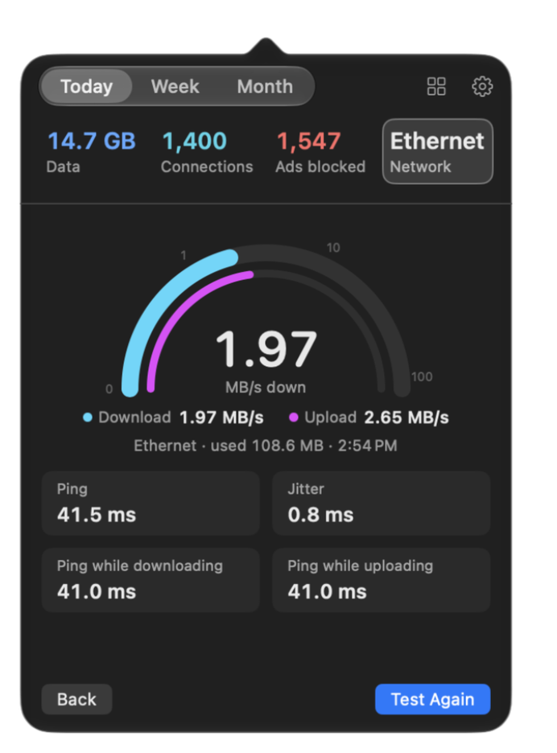

# 网速测试

[English](../speed-test.md) · 简体中文

  

点按弹出窗口中的<strong>仪表</strong>，从右键菜单中选择 <strong>测试网速</strong>，或者打开 <strong>设置 › 网速测试</strong>。 NetworkMonitor 会运行 `networkQuality`，这是 Apple 自 Monterey 起随每台 Mac 附带的网速测试工具，测试对象是离你最近的 Apple 服务器。

## 测试结果

- <strong>先测下载，再测上传</strong>，依次进行，和其他网速测试一样。表盘跟随正在进行的那一半。
- <strong>延迟和抖动</strong>（线路空闲时），以及 <strong>下载时的延迟</strong> 和 <strong>上传时的延迟</strong>：当其他内容占满线路时，另一个应用需要等待多久。正是这个数值能解释为什么大文件下载期间通话会卡顿。将指针悬停在任一数值上，可以查看它的含义。
- <strong>每次都重新测量。</strong> 不缓存，也不重复使用任何结果。
- <strong>是什么拖慢了速度。</strong> NetworkMonitor 本来就知道哪些应用正在使用连接。如果某个应用传输了至少 1 MB，并且至少相当于测试流量的 5%，结果会写明是哪个应用，并提醒数值可能偏低。否则，如果负载下延迟上升 100 ms 或更多，它会提示下载大文件期间通话可能会卡顿。
- <strong>Mbps 或 MB/s</strong>，与菜单栏使用同一个选项（<strong>设置 › 通用 › 速度显示单位</strong>）。Mbps 与宽带的销售方式一致； MB/s 与流量累计值一致。

## 显示位置

- <strong>卡片</strong>（默认）会取代应用列表的位置，显示一个表盘和所有数值。<strong>返回应用</strong> 会让正在进行的测试继续进行，并重新显示列表；这时仪表会显示实时读数，点按它即可回到测试。<strong>停止</strong> 才会停止测试。
- <strong>紧凑</strong> 会把测试显示为应用上方的两个细长仪表，测试完成后在下方显示延迟和抖动。列表始终可见，只是让出相应的高度，因此弹出窗口不会变大。
- <strong>菜单栏</strong>，始终显示。测试进行期间，读数以青色显示，因此它的数值绝不会被误认为是实时速度，宽度也与平时的读数完全相同。如果你给实时速度设置的颜色接近青色（设置 › 通用 › 菜单栏颜色），测试会改用粉色、琥珀色或紫色，“通用”中会显示用的是哪种颜色。结果会保留 8 秒，然后恢复显示实时速度。如果从右键菜单开始测试，就在这里观看。

在 <strong>设置 › 网速测试</strong> 中选择“卡片”或“紧凑”。

## 流量消耗

测试会消耗真实的流量，通常为 <strong>50–500 MB</strong>，网速很快时会更多。因此：

- <strong>在按流量计费的连接上，它会先询问你</strong>，并显示上次在这个连接上测试用了多少流量。在你点按 <strong>仍然测试</strong> 之前，不会消耗任何流量。
- 它的流量在应用列表中显示为 <strong>网速测试</strong>，位于 Network Monitor 之下，并计入你的累计值和流量历史，因为这些字节确实通过了这个连接。
- <strong>测试中途切换网络会结束测试</strong>；跨越两个网络的测试哪个网络都测不准。上一次的结果也会被清除，因为它描述的是你离开的那个网络。

## 实现方式

<strong>测试引擎</strong>是 `/usr/bin/networkQuality`。如果 Mac 上没有它，仪表和菜单项会隐藏，“设置”会说明原因。我们也考虑过其他引擎，但都没有采用：

| 选项 | 不采用的原因 |
|---|---|
| Ookla 的 CLI | 需要另行安装，而且它的许可证不允许捆绑在 MIT 许可的应用中 |
| M-Lab NDT | 会把每个测试者的 IP 地址和结果作为开放数据公开 |
| Cloudflare 的端点，或者我们自己的端点 | 意味着要维护一个测量引擎，而它还不如每台 Mac 上已有的那个 |
| fast.com | 没有 API |

<strong>运行方式</strong>（`SpeedTestRunner.swift`）是 `networkQuality -s -v -c<file>`：

- `-s` <strong>依次</strong>运行下载和上传。在默认的并行模式下，两个方向会相互争抢，因此在上下行不对称或缓冲很深的线路上，两者的读数都会偏低；依次运行还能为每个方向分别得到负载下的延迟。
- `-v` 会在实时输出行中加入字节数，因此卡片可以显示测试到目前为止用了多少流量。
- `-c` 会以 JSON 格式写入结果。路径必须紧跟在这个参数后面。
- <strong>不使用 <code>-M</code> 时间限制：</strong> 限制时长的测试会丢弃尚未收敛的数值。

它在一个<strong>伪终端</strong>中运行，因为通过管道运行时，这个工具在结束之前什么都不输出。`nettop` 在伪终端中运行也是同样的原因；参阅[架构](../architecture.md#nettop-who-used-it)（英文）。实时输出行大约每秒重绘五次，并随时解析。运行超过 90 秒的测试会被停止。

之后会进行一次简短的<strong>仅测延迟的过程</strong>（`-d -u`，不到一秒，不产生测试流量），再增加八个空闲样本，因为在 Wi-Fi 上，单独一批空闲延迟样本在相隔一分钟的两次测试之间，从 49 ms 到 74 ms 不等。

<strong>数值的计算</strong>（`SpeedTest.swift`）：

- <strong>延迟</strong>是两次过程中空闲请求/响应时间的四分位平均值，也就是中间一半的平均值，与 Ookla 的报告方式相同。普通平均值会让一个卡住的探测（在一组 75 左右的数值中出现 633 ms）把结果拉高；最小值又会美化线路。包含握手的 `base_rtt` 只作为后备。
- <strong>抖动</strong>是相邻空闲样本之间差值的平均值，只在每个过程内部计算，绝不跨两个过程计算。
- <strong>负载下的延迟</strong>来自线路占满时另外打开的连接：也就是另一个应用实际感受到的情况。
- <strong>刻意不显示 RPM 和 Apple 的响应能力评级。</strong> RPM 是 Apple 自己的单位，它把已占满的连接内部的延迟（在缓冲很深的线路上可达数秒）和另一个应用实际等待的时间混在一起。

<strong>从设计上保证每次都是新结果。</strong> 每次测试都是一个新进程，运行在自己的文件夹 `$TMPDIR/NetworkMonitor-speedtest-<UUID>/` 中，读取结果后立即删除，无论成功、失败、超时还是取消。结果只能来自刚刚完成的那次测试。取消时先发送 `SIGTERM`，0.3 秒后再发送 `SIGKILL`。如果应用在测试中途被强制退出，留下的文件夹会在下次启动时删除，前提是它已超过 10 分钟，因此绝不会碰到另一个进程中正在进行的测试。

<strong>状态</strong>（`SpeedTestController.swift`）依次为空闲 → 确认中（仅限按流量计费的连接）→ 运行中 → 已完成或已失败。实时读数是与阶段分开的另一个可观察对象，因此应用列表不会每秒重建五次。

<strong>偏好设置：</strong> `speedTestUnit`（`bits` 或 `bytes`，默认为 bytes；以网速测试命名，因为这个设置最早出现在网速测试中，保留这个名称是为了让以前的选择继续有效）和 `speedTestStyle`（`card` 或 `compact`）。

<strong>测试</strong>（`SpeedTestTests.swift`）从不消耗流量。解析器和解码器使用从真实工具捕获的输出进行测试。运行器和控制器使用一个替代的 `networkQuality` 脚本进行测试，它会输出同类内容、写入 JSON，还可以让它失败、让它的延迟测试过程失败，或者让它运行得很慢。开发时请尽量少运行真实测试：每次都会消耗真实的流量。
